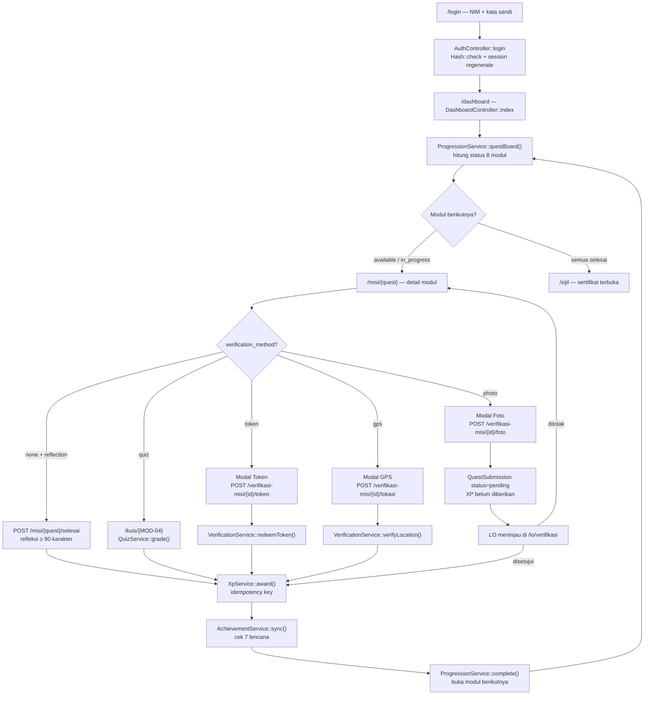
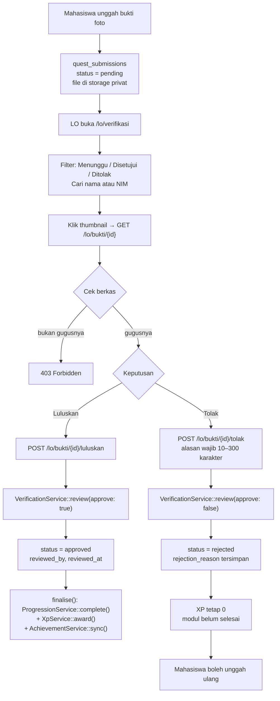
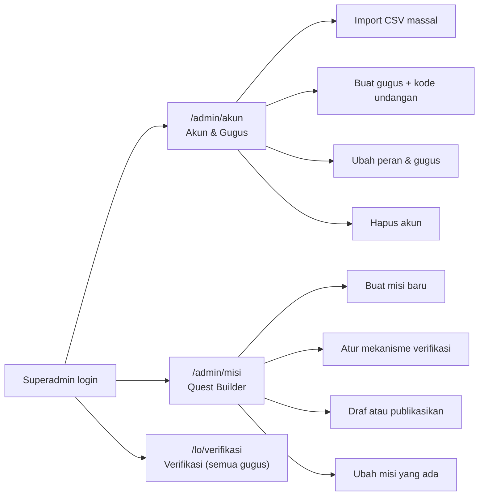

# OspekQuest — Alur Kerja Mahasiswa, LO, dan Admin

Dokumen ini menjelaskan **alur nyata** setiap peran di OspekQuest, diturunkan langsung
dari kode di `app/`, `routes/web.php`, dan `config/ospek.php`. Setiap langkah menyebut
nama class/metode yang benar-benar menjalankannya, supaya bisa ditelusuri saat presentasi
atau saat ada bug.

---

## 0. Tiga Peran, Satu Aplikasi

| Peran | Nilai `users.role` | Label UI | Masuk lewat | Halaman pertama |
|---|---|---|---|---|
| Mahasiswa baru | `student` | Mahasiswa Baru | `/login` (NIM) | `/dashboard` |
| Liaison Officer | `lo` | LO (Kakak Tingkat) | `/login` (NIM/ID) | `/dashboard` → menu **Verifikasi Bukti** |
| Superadmin | `admin` | Superadmin | `/login` (NIM/ID) | `/dashboard` → menu **Akun & Gugus**, **Quest Builder** |

> **Catatan penting:** tidak ada peran `mentor` terpisah. Metode `User::isMentor()`
> mengembalikan `true` untuk **LO dan Admin** (`UserRole::canReviewTickets()`), karena
> keduanya boleh membalas tiket bantuan. Yang membedakan LO dari Admin adalah
> `canManageAccounts()` dan `canBuildQuests()` — hanya Admin.

### Peta hak akses

| Kemampuan | Mahasiswa | LO | Admin |
|---|:--:|:--:|:--:|
| Kerjakan modul, kuis, refleksi | ✅ | — | — |
| Lihat peta misi / lencana / sertifikat / peringkat | ✅ | — | — |
| Ajukan tiket bantuan | ✅ | — | — |
| **Tinjau bukti foto** | — | ✅ gugus sendiri | ✅ semua |
| Balas tiket bantuan | — | ✅ | ✅ |
| Kelola akun & gugus (CSV, ubah peran) | — | — | ✅ |
| Buat/ubah misi (Quest Builder) | — | — | ✅ |

Ditegakkan oleh `middleware(['auth', 'role:...'])` → `App\Http\Middleware\EnsureRole`,
ditambah `abort_unless(...)` di dalam controller, dan `User::canReviewSubmissionOf()`
untuk batas per-gugus.

---

## 1. Alur Mahasiswa (Student)

### 1.1 Perjalanan dari login sampai sertifikat



### 1.2 Status modul — bagaimana ditentukan

`ProgressionService::questBoard(User $user)` menghitung status dari **tiga sumber**
sekaligus, bukan dari satu kolom yang bisa dimanipulasi:

1. **Progres tersimpan** — `user_quests.status`
2. **Urutan langkah** — `quests.step_number` (modul sebelumnya harus `completed`)
3. **Gerbang waktu** — `quests.unlock_day` ≤ hari orientasi berjalan

```php
$status = match (true) {
    $userQuest?->status === QuestStatus::Completed => QuestStatus::Completed,
    ! $quest->isUnlockedOnDay($day)               => QuestStatus::Locked,
    ! $previousCompleted                          => QuestStatus::Locked,
    $userQuest?->status === QuestStatus::InProgress => QuestStatus::InProgress,
    default                                        => QuestStatus::Available,
};
```

Empat status yang mungkin:

| Status | Arti | Alasan terkunci yang ditampilkan |
|---|---|---|
| `locked` | Belum bisa dikerjakan | "Terbuka pada hari ke-N orientasi." atau "Selesaikan modul sebelumnya terlebih dahulu." |
| `available` | Siap dimulai | — |
| `in_progress` | Sudah diklik mulai | — |
| `completed` | Selesai, XP sudah masuk | — |

**Hari orientasi** dihitung `ProgressionService::orientationDay()`:
`min(hari berjalan sejak OSPEK_START_DATE, OSPEK_TOTAL_DAYS)`.
Kalau tanggal mulai belum tiba (`orientationDay() === 0`), `effectiveDay()` mengembalikan
jumlah hari penuh — artinya **saat demo sebelum acara, semua modul terbuka** agar bisa
diperlihatkan ke juri. Setelah acara lewat, hari di-*clamp* supaya tidak muncul
"Hari ke-74 dari 8".

### 1.3 Delapan modul dan cara menyelesaikannya

Data aktual dari database (`quests` setelah seeder):

| Kode | Judul | Hari | XP | Aksi | Verifikasi | Cara menyelesaikan |
|---|---|:--:|:--:|---|---|---|
| MOD-01 | Registrasi Ulang & Verifikasi Berkas | 1 | 100 | `photo_proof` | **photo** | Unggah bukti → tunggu LO setujui |
| MOD-02 | Jelajah Perpustakaan & Repositori Digital | 2 | 120 | `checkin` | **token** | Masukkan kode dari stan perpustakaan |
| MOD-03 | Pertemuan Kelompok & Mentor Pendamping | 3 | 150 | `reflection` | none | Tulis refleksi ≥ 80 karakter + centang konfirmasi |
| MOD-04 | Kuis Sistem Kredit Semester & Etika Akademik | 4 | 250 | `quiz` | none | Kerjakan kuis, minimal skor 80% |
| MOD-05 | Apel Orientasi Akbar di Auditorium UMK | 5 | 350 | `geolocation` | **gps** | Berada dalam radius 150 m dari auditorium |
| MOD-06 | Eksplorasi Stan Muria Computing Club (MCC) | 6 | 250 | `token` | **token** | Masukkan kode dari stan MCC |
| MOD-07 | Proyek Mini: Solusi Digital untuk Kampus | 7 | 280 | `reflection` | none | Tulis refleksi ≥ 80 karakter |
| MOD-08 | Upacara Penutupan & Sertifikat Orientasi | 8 | 300 | `geolocation` | **gps** | Verifikasi lokasi di titik upacara |

Total XP dari modul: **1.800 XP**. Ditambah XP lencana, reasoning skor kuis, dan bonus.

### 1.4 Empat jalur penyelesaian — detail teknis

#### (a) Modul biasa / refleksi — `POST /misi/{quest}/selesai`

```
QuestController::complete(CompleteQuestRequest, Quest)
  ├─ statusFor() → harus isOpen(), kalau tidak → 422 "Modul belum terbuka"
  ├─ action_type === Quiz?          → redirect ke /kuis/{module}
  ├─ requiresVerification()?        → 422 "Modul ini memerlukan verifikasi {metode}"
  ├─ action_type === Reflection?    → reflection wajib ≥ 80 karakter
  ├─ checkpointXp()                 → XP = quests.xp_reward (kecuali kuis = 0)
  ├─ ProgressionService::complete() → status completed + buka modul berikutnya
  ├─ XpService::award()             → idempotency key "quest:{user}:{quest}"
  └─ AchievementService::sync()     → buka lencana yang memenuhi syarat
```

Validasi form ada di `CompleteQuestRequest`:

```php
'reflection' => ['nullable', 'string', 'min:80', 'max:1200'],
'confirm'    => ['accepted'],   // centang konfirmasi wajib
```

#### (b) Kuis — `POST /kuis/mulai` lalu `POST /kuis/jawab`

`QuizService` memasang **tiga pengaman** yang tidak ada di versi lama:

| Pengaman | Nilai | Konsekuensi |
|---|---|---|
| Batas percobaan | `max_attempts = 3` | Percobaan ke-4 ditolak |
| Batas waktu sisi server | `time_limit_seconds = 300` + grace 20 detik | Waktu mulai diambil dari **sesi**, bukan dari body request |
| XP sekali pakai | key `quiz:{user}:{module}` | Lulus berkali-kali tetap satu award |

Alur `QuizController::start()` → `QuizService` menyimpan
`quiz.started_at.{module}` di sesi, lalu `submit()` memakai stempel itu untuk menghitung
`elapsed`. Klaim `time_taken` dari browser **tidak dipercaya**.

Penilaian: `pass_percentage = 80`. Jika lulus →
`ProgressionService::complete()` dipanggil otomatis dan XP diambil dari
**jumlah `xp_reward` per soal yang benar**, bukan dari `quests.xp_reward`.

#### (c) Token stan — `POST /verifikasi-misi/{quest}/token`

`VerificationService::redeemToken()` memeriksa berurutan:

1. `assertVerifiable()` — modul harus terbuka **dan** metodenya memang token
2. Token sudah diatur? (`hasToken()`)
3. Kedaluwarsa? (`tokenExpired()`)
4. Kuota habis? (`tokenQuotaExhausted()`)
5. Sudah pernah klaim? (`token_redemptions` per user+quest)
6. Cocok? `Hash::check(strtoupper(trim($token)), $quest->token_hash)`

Penyimpanan token memakai `Hash::make()` di `Quest::setPlainToken()`, jadi **plaintext
tidak pernah masuk database**. Penjaga terakhir adalah `insertOrIgnore()` pada tabel
`token_redemptions` dengan unique index — dua request bersamaan tetap hanya menghasilkan
satu klaim.

#### (d) GPS — `POST /verifikasi-misi/{quest}/lokasi`

```
VerificationService::verifyLocation($user, $quest, $lat, $lng, $accuracy)
  ├─ assertVerifiable()                    ← gerbang modul lebih dulu
  ├─ accuracy > 500 m?  → tolak "Sinyal GPS terlalu lemah"
  ├─ hasGeofence()?     → titik acuan harus diatur panitia
  ├─ haversineMeters()  → hitung jarak di SERVER
  └─ distance > radius? → tolak "Anda berada N m dari lokasi"
```

Akurasi diperiksa **setelah** gerbang modul — ini perbaikan bug: sebelumnya mahasiswa
menerima pesan "GPS lemah" untuk modul yang sebenarnya masih terkunci.

#### (e) Foto — `POST /verifikasi-misi/{quest}/foto`

`VerificationService::submitPhotoProof()` **tidak** menyelesaikan modul. Yang terjadi:

- Berkas disimpan di disk **privat**: `storage/app/private/proofs/{user_id}/`
- Baris `quest_submissions` dibuat dengan `status = pending`
- `user_quests` **tidak berubah**, XP **tidak** diberikan
- Pesan: "Bukti terkirim. Menunggu tinjauan LO gugus Anda."

Kalau sebelumnya sudah `pending` → ditolak ("Bukti Anda sedang menunggu tinjauan LO").
Kalau sebelumnya `rejected` → boleh unggah ulang (status kembali `pending`).

### 1.5 XP, level, lencana

**XP hanya bisa bertambah lewat satu pintu:** `XpService::award()`. Setiap award wajib
membawa `idempotencyKey`; kalau key sudah ada di `xp_transactions`, award **dilewati**.
Ini yang mencegah farming XP dengan mengulang kuis atau mengirim ulang request.

```php
$this->xp->award(
    $user, $amount, $sourceType, $sourceId, $description,
    "quest:{$user->getKey()}:{$quest->getKey()}",   // ← idempotency key
);
```

Saldo dihitung di dalam transaksi dengan `lockForUpdate()` sehingga request paralel tidak
bisa menghasilkan saldo ganda.

**Pita level** (`config/ospek.php`):

| Level | Gelar | Min XP |
|:--:|---|---:|
| 1 | Maba Pemula | 0 |
| 2 | Penjelajah Kampus | 300 |
| 3 | Pengembara Siswa | 750 |
| 4 | Perintis Kampus | 1.400 |
| 5 | Mentor Muda | 2.200 |
| 6 | Mahasiswa Legenda | 3.200 |
| 7 | Duta Orientasi | 4.500 |

**Tujuh lencana** — semuanya dihitung ulang dari data nyata oleh
`AchievementService::sync()`, bukan di-hardcode:

| Lencana | Metrik | Target | Bonus XP |
|---|---|:--:|--:|
| Langkah Pertama | `quests_completed` | 1 | +50 |
| Setengah Jalan | `quests_completed` | 4 | +150 |
| Cendekiawan Akademik | `perfect_quizzes` | 1 | +200 |
| Rentetan Konsisten | `streak_days` | 5 | +180 |
| Pemburu Poin | `total_xp` | 1.500 | +160 |
| Sahabat Mentor | `help_tickets_answered` | 1 | +120 |
| Mahasiswa Sejati | `quests_completed` | 8 | +500 |

Saat lencana pertama terbuka, mahasiswa bisa menerima **XP modul + XP lencana** sekaligus —
karena itu tes "selesaikan modul pertama" memakai `assertGreaterThanOrEqual`, bukan
kesamaan persis.

**Rentetan harian** dihitung `StreakService::touch()` yang dipanggil middleware
`TrackDailyActivity` setiap kali ada request `GET` dan `last_active_on` bukan hari ini.

### 1.6 Sertifikat

`CertificateService::isEligible()` mensyaratkan **dua** hal:

```php
return $user->orientation_completed_at !== null
    && $this->completedQuests($user) >= $this->totalQuests();
```

`orientation_completed_at` diisi otomatis oleh `ProgressionService::syncCompletionFlag()`
begitu jumlah modul selesai mencapai total. Jadi sertifikat tidak bisa dicetak dengan
progres 0/8 — ini bug versi lama yang sudah ditutup.

Kode verifikasi: `OSQ-{tahun}-{8 hex}` (contoh `OSQ-26-83AF6F3B`), bisa dicek publik di
`/verifikasi/{code}` — halaman itu hanya menampilkan keabsahan, bukan data pribadi lengkap.

### 1.7 Bantuan: tiket ke mentor

Tab **Pusat Bantuan** di `/profil?tab=helpdesk`:

1. Mahasiswa mengisi subjek, kategori, pesan → `ProfileController::submitHelpTicket()`
2. Baris `help_tickets` dibuat dengan `status = open`
3. LO/Admin membalas di `/lo/tiket` → `MentorController::reply()`, status jadi `answered`
4. Setelah dijawab, lencana **Sahabat Mentor** bisa terbuka
   (`help_tickets_answered >= 1`)

---

## 2. Alur Liaison Officer (LO)

LO adalah kakak tingkat yang mendampingi satu gugus. Batas wewenangnya **satu gugus**,
ditegakkan `User::canReviewSubmissionOf()`.

### 2.1 Membuka portal verifikasi

```
GET /lo/verifikasi → LiaisonOfficerController::index()
  ├─ abort_unless($officer->role->canVerifySubmissions(), 403)
  ├─ ambil semua user_id dengan group_id = group_id LO
  ├─ hitung statistik gugus (pending, approved, rejected, efficiency)
  └─ tampilkan antrean bukti, urut terlama dulu
```

Menu **Verifikasi Bukti** hanya muncul di sidebar bila `$navUser->isMentor()`.

### 2.2 Alur peninjauan bukti



### 2.3 Aturan yang ditegakkan `VerificationService::review()`

| Pemeriksaan | Pesan bila gagal |
|---|---|
| `$reviewer->role->canVerifySubmissions()` | "Anda tidak berwenang meninjau bukti misi." |
| `canReviewSubmissionOf($student)` | "Mahasiswa ini bukan anggota gugus Anda." |
| `status === Pending` | "Bukti ini sudah ditinjau sebelumnya." |
| Alasan wajib saat menolak | "Alasan penolakan wajib diisi agar mahasiswa tahu apa yang harus diperbaiki." |

Urutan penting: **status diubah dulu**, baru `finalise()` dipanggil di dalam
`DB::transaction` yang sama. Kalau XP gagal diberikan, seluruh perubahan di-rollback.

### 2.4 Menyajikan berkas bukti secara privat

`LiaisonOfficerController::proof()`:

```
GET /lo/bukti/{submission}
  ├─ abort_unless($officer->canReviewSubmissionOf($submission->user), 403)
  ├─ abort_if(proof_path === null, 404)
  ├─ abort_unless(Storage::disk('local')->exists(path), 404)
  └─ return Storage::disk('local')->response(path)
```

Berkas **tidak** ada di `public/`, jadi tidak bisa diakses lewat URL tebakan. Diverifikasi:
`storage/app/private/proofs/{user_id}/…` dan `find public -name "*bukti*"` → kosong.

### 2.5 Statistik yang dilihat LO

`LiaisonOfficerController::stats()` menghitung, dibatasi `group_id` LO:

| Angka | Rumus |
|---|---|
| Menunggu Verifikasi | `status = pending` dari anggota gugus |
| Disetujui | `status = approved` + jumlah hari ini |
| Ditolak | `status = rejected` |
| Rasio Kelulusan | `approved / (approved + rejected) × 100` |

### 2.6 Membalas tiket bantuan

`GET /lo/tiket` → daftar tiket semua mahasiswa (bukan hanya gugusnya), tiket `open`
diurutkan paling atas. `POST /lo/tiket/{ticket}/balas` mengisi `reply`, `answered_by`,
`answered_at`, dan status `answered`.

### 2.7 Yang **tidak** bisa dilakukan LO

- Membuka `/admin/akun` dan `/admin/misi` → **403** (diuji di `AccountManagementTest`)
- Meluluskan mahasiswa gugus lain → **403 / validation error** (diuji di `AntiCheatVerificationTest`)
- Membuat atau mengubah misi
- Mengubah peran akun

---

## 3. Alur Superadmin

### 3.1 Tiga tugas utama



### 3.2 Import massal mahasiswa — `POST /admin/akun/import`

Berkas CSV, urutan kolom **wajib**:

```
NIM, Nama Penuh, Jurusan, Email Kampus, Kode Gugus
202653900,Ayu Pramesti,Sistem Informasi,ayu@student.umk.ac.id,G-04
```

Perilaku `AccountController::bulkImport()`:

| Situasi | Yang terjadi |
|---|---|
| NIM kosong atau nama kosong | Baris dilewati, dicatat di daftar `import_skipped` |
| NIM sudah terdaftar | Baris dilewati (tidak menimpa data lama) |
| Kode gugus cocok `code`, `invitation_code`, atau `name` | Mahasiswa masuk gugus tersebut |
| Kode gugus tidak dikenal | **Dilaporkan** sebagai baris bermasalah, bukan diam-diam null |
| Kolom gugus kosong | Akun dibuat tanpa gugus (sah) |
| `auto_generate_password` dicentang | Sandi acak 10 karakter per akun |
| Tidak dicentang | Sandi awal `password` |
| Berkas bukan CSV | Ditolak validasi `mimes:csv,txt` |

Satu baris bermasalah **tidak** menggagalkan seluruh berkas — penting untuk impor 3.000
mahasiswa sekaligus. Seluruh baris valid dijalankan dalam satu `DB::transaction`.

### 3.3 Membuat gugus — `POST /admin/akun/gugus`

Isian: nama gugus, program studi, LO utama, kapasitas, warna lencana.
Efek samping yang penting:

1. `code` dibuat otomatis (`G-05`, `G-06`, …)
2. `invitation_code` diacak (`KELOMP-0C23`)
3. **LO otomatis dipindahkan ke gugus itu** (`$mentor->forceFill(['group_id' => ...])`)
   — tanpa ini LO tidak bisa meninjau bukti gugus yang ia bimbing

Validasi: nama unik, `mentor_id` harus benar-benar berperan `lo` (bukan mahasiswa).

### 3.4 Ubah peran & hapus akun

- `POST /admin/akun/{user}/peran` — ubah `role` + `group_id`
- `DELETE /admin/akun/{user}` — hapus akun

Dua pagar pengaman:

| Pagar | Alasan |
|---|---|
| Admin tidak bisa menurunkan peran sendiri | Mencegah terkunci di luar panel |
| Admin tidak bisa menghapus akun sendiri | Sama |

### 3.5 Quest Builder — `GET/POST /admin/misi`

Form empat bagian: informasi dasar, target sasaran, kolaborasi UKM, mekanisme verifikasi.
Panel kanan menampilkan **pratinjau live** kartu misi seperti yang dilihat mahasiswa.

**Validasi silang** di `QuestBuilderController::validated()` — ini yang mencegah modul
mustahil diselesaikan:

| Metode verifikasi | Syarat wajib |
|---|---|
| `token` | `token_code` wajib (kecuali sudah ada hash lama) |
| `gps` | `latitude` dan `longitude` wajib |
| `photo` | tidak ada syarat tambahan |
| `none` | tidak ada syarat tambahan |

Aturan lain:

- `step_number` **harus unik** → menentukan kode `MOD-xx`. Tanpa aturan ini dua modul
  mendapat kode sama dan meledak sebagai `SQLSTATE[23000]` di tingkat database.
- Kode kuis ikut di-*pad*: `MOD-09`, bukan `MOD-9`.
- Saat mengubah misi, kode modul ikut berubah mengikuti urutan baru — **kecuali** modul
  kuis yang sudah punya percobaan, agar riwayat `quiz_attempts` tidak yatim.
- Token disimpan sebagai hash; plaintext tidak pernah menyentuh database.

Tombol ganda: **Simpan Draf** (`status = draft`, tidak tampil ke mahasiswa) dan
**Simpan & Publikasikan** (`status = published`).

### 3.6 Verifikasi lintas gugus

Admin boleh membuka `/lo/verifikasi` dan meninjau bukti **semua** gugus, karena
`User::canReviewSubmissionOf()` mengembalikan `true` lebih awal untuk admin.

---

## 4. Titik Temu Antar Peran

| Kejadian | Mahasiswa | LO | Admin |
|---|---|---|---|
| Unggah bukti foto | status `pending`, XP 0 | melihat di antrean | melihat semua gugus |
| Bukti disetujui | XP masuk, modul selesai, modul berikutnya terbuka | statistik "Disetujui" naik | — |
| Bukti ditolak | pesan alasan tampil, boleh unggah ulang | statistik "Ditolak" naik | — |
| Tiket dibuat | status `open` | membalas | membalas |
| Tiket dijawab | lencana "Sahabat Mentor" bisa terbuka | — | — |
| Akun dibuat admin | bisa login | mahasiswa masuk gugusnya | — |
| Misi baru dipublikasikan | muncul di peta misi | — | membuatnya |

---

## 5. Yang Menjaga Semua Ini Tetap Jujur

Delapan aturan yang ditegakkan **di server**, bukan di JavaScript:

1. **Modul terkunci tidak bisa diselesaikan** — status dihitung ulang setiap request
   (`ProgressionService::statusFor()`), bukan dibaca dari kolom yang bisa diubah.
2. **XP idempoten** — setiap award membawa `idempotency_key` unik di `xp_transactions`.
3. **Token sekali pakai per akun**, dengan kuota dan kedaluwarsa.
4. **Radius GPS dihitung di server** dengan formula haversine; akurasi > 500 m ditolak.
5. **Bukti foto tidak memberi XP** sampai LO gugus menyetujui.
6. **LO hanya bisa meninjau gugusnya** — URL yang dimanipulasi tetap 403.
7. **Berkas bukti disimpan privat** dan disajikan lewat rute ber-otorisasi.
8. **Kuis memakai timer sisi server**; waktu mulai diambil dari sesi, bukan body request.

Permukaan verifikasi juga dibatasi rate limit: `throttle:12,1` pada semua rute
`/verifikasi-misi/*`, dan `throttle:6,1` pada `POST /login`.

---

## 6. Peta Rute per Peran

### Mahasiswa (middleware `auth`, `activity`)

| Method | Rute | Nama | Controller |
|---|---|---|---|
| GET | `/dashboard` | `dashboard` | `DashboardController@index` |
| GET | `/misi` | `quests.index` | `QuestController@index` |
| GET | `/misi/{quest}` | `quests.show` | `QuestController@show` |
| POST | `/misi/{quest}/mulai` | `quests.start` | `QuestController@start` |
| POST | `/misi/{quest}/selesai` | `quests.complete` | `QuestController@complete` |
| POST | `/verifikasi-misi/{quest}/token` | `verify.token` | `VerificationController@token` |
| POST | `/verifikasi-misi/{quest}/lokasi` | `verify.location` | `VerificationController@location` |
| POST | `/verifikasi-misi/{quest}/foto` | `verify.photo` | `VerificationController@photo` |
| GET | `/kuis/{module?}` | `quiz` | `QuizController@index` |
| POST | `/kuis/mulai` | `quiz.start` | `QuizController@start` |
| POST | `/kuis/jawab` | `quiz.submit` | `QuizController@submit` |
| GET | `/pencapaian` | `achievements` | `AchievementController@index` |
| GET | `/sijil` | `certificate` | `CertificateController@show` |
| GET | `/peringkat` | `leaderboard` | `LeaderboardController@index` |
| GET/POST | `/profil` | `profile` / `profile.update` | `ProfileController` |
| POST | `/bantuan/tiket` | `help.ticket` | `ProfileController@submitHelpTicket` |

### LO (middleware `auth`, `role:lo,admin`)

| Method | Rute | Nama | Controller |
|---|---|---|---|
| GET | `/lo/verifikasi` | `lo.dashboard` | `LiaisonOfficerController@index` |
| GET | `/lo/bukti/{submission}` | `lo.proof` | `LiaisonOfficerController@proof` |
| POST | `/lo/bukti/{submission}/luluskan` | `lo.approve` | `LiaisonOfficerController@approve` |
| POST | `/lo/bukti/{submission}/tolak` | `lo.reject` | `LiaisonOfficerController@reject` |
| GET | `/lo/tiket` | `lo.tickets` | `MentorController@tickets` |
| POST | `/lo/tiket/{ticket}/balas` | `lo.tickets.reply` | `MentorController@reply` |

### Admin (middleware `auth`, `role:admin`)

| Method | Rute | Nama | Controller |
|---|---|---|---|
| GET | `/admin/akun` | `admin.accounts` | `AccountController@index` |
| POST | `/admin/akun/import` | `admin.accounts.import` | `AccountController@bulkImport` |
| GET | `/admin/akun/template` | `admin.accounts.template` | `AccountController@template` |
| POST | `/admin/akun/{user}/peran` | `admin.accounts.role` | `AccountController@updateRole` |
| DELETE | `/admin/akun/{user}` | `admin.accounts.destroy` | `AccountController@destroy` |
| POST | `/admin/akun/gugus` | `admin.groups.store` | `AccountController@storeGroup` |
| GET | `/admin/misi` | `admin.quests.index` | `QuestBuilderController@index` |
| POST | `/admin/misi` | `admin.quests.store` | `QuestBuilderController@store` |
| PUT | `/admin/misi/{quest}` | `admin.quests.update` | `QuestBuilderController@update` |

### Publik

| Method | Rute | Nama | Controller |
|---|---|---|---|
| GET | `/login` | `login` | `AuthController@showLogin` |
| POST | `/login` | `login.post` | `AuthController@login` (`throttle:6,1`) |
| POST | `/logout` | `logout` | `AuthController@logout` |
| GET | `/verifikasi/{code?}` | `certificate.verify` | `CertificateController@verify` |

---

## 7. Berkas yang Perlu Dibuka Saat Presentasi

| Kalau juri bertanya… | Buka file ini |
|---|---|
| "Bagaimana status modul ditentukan?" | `app/Services/ProgressionService.php` |
| "Bagaimana mencegah curang?" | `app/Services/VerificationService.php` |
| "Bagaimana XP tidak bisa di-farm?" | `app/Services/XpService.php` |
| "Bagaimana penilaian kuis?" | `app/Services/QuizService.php` |
| "Bagaimana lencana terbuka?" | `app/Services/AchievementService.php` |
| "Kenapa sertifikat tidak bisa dipalsukan?" | `app/Services/CertificateService.php` |
| "Apa saja rutenya?" | `routes/web.php` (129 baris) |
| "Apa saja aturan bisnisnya?" | `config/ospek.php` |

---

## 8. Akun Demo untuk Demonstrasi

Dari seeder, semuanya bersandi `password`:

| Peran | ID | Nama | Gugus |
|---|---|---|---|
| Mahasiswa | `202653033` | Aldiansyah Fayruz | Kelompok 04 — Garuda |
| Mahasiswa | `202653044` | Muhammad Viza Fairuzzeka | Kelompok 04 — Garuda |
| Mahasiswa | `202653078` | Bagas Dwi Prasetyo | Kelompok 04 — Garuda |
| Mahasiswa | `202653067` | Vicko Amelino Syahputra | Kelompok 02 — Elang |
| Mahasiswa | `202653012` | Aisyah Nur Fadhilah | Kelompok 02 — Elang |
| Mahasiswa | `202653101` | Citra Ayu Lestari | Kelompok 01 — Merpati |
| Mahasiswa | `202653055` | Dimas Arya Saputra | Kelompok 03 — Kancil |
| LO | `LO-2022-001` | Kak Nissa | Kelompok 04 — Garuda |
| LO | `LO-2022-002` | Kak Syakirah | Kelompok 01 — Merpati |
| LO | `LO-2022-003` | Kak Dimas | Kelompok 02 — Elang |
| LO | `LO-2022-004` | Kak Rahul | Kelompok 03 — Kancil |
| Admin | `ADMIN-01` | Dr. Rian Ardianto | — |

Pasangan yang dipakai untuk menguji batas wewenang LO:
`202653033` (gugus 04) sebagai mahasiswa, `LO-2022-001` sebagai LO yang **berhak**,
dan `LO-2022-002` (gugus 01) sebagai LO yang harus **ditolak**.

### Urutan demo yang paling meyakinkan

1. **Login mahasiswa** `202653033` → tunjukkan dasbor, hari orientasi, peta misi
2. **Buka MOD-01** → unggah bukti foto → perhatikan **XP belum bertambah**
3. **Login LO** `LO-2022-001` → buka `/lo/verifikasi` → lihat antrean berisi bukti tadi
4. **Coba LO gugus lain** `LO-2022-002` → buka bukti yang sama → **403 Forbidden**
5. **Kembali ke LO gugus 04** → klik **Luluskan** → XP mahasiswa bertambah
6. **Login mahasiswa lagi** → MOD-02 terbuka → masukkan token `PERPUS-UMK-26`
7. **Kirim token yang sama dua kali** → ditolak "Modul ini sudah selesai"
8. **Coba POST modul terkunci** (mis. MOD-05) → ditolak "belum terbuka"
9. **Login Admin** → tunjukkan import CSV, pembuatan gugus, Quest Builder
10. **Sertifikat**: jalankan `php storage/app/finish-all.php 202653012` lalu buka `/sijil`

    Skrip itu menyelesaikan **seluruh 8 modul dalam satu putaran** lewat jalur service
    yang sah — termasuk mengunggah bukti foto **lalu langsung menyetujuinya** di langkah
    yang sama. Ini penting: kalau persetujuan ditunda sampai akhir, MOD-02 dan seterusnya
    masih terkunci saat gilirannya tiba dan skrip hanya menghasilkan 7/8.

    Hasil terverifikasi: `8/8 modul`, `3.770 XP`, `Level 6`, `5 lencana`, sertifikat
    `OSQ-26-E87761CE` terbuka dan lolos verifikasi publik.

> Di lingkungan demo sebelum tanggal orientasi, semua gerbang waktu otomatis terbuka
> (`effectiveDay()` mengembalikan jumlah hari penuh), jadi tidak perlu menunggu tanggal
> asli untuk memperlihatkan modul hari ke-8.