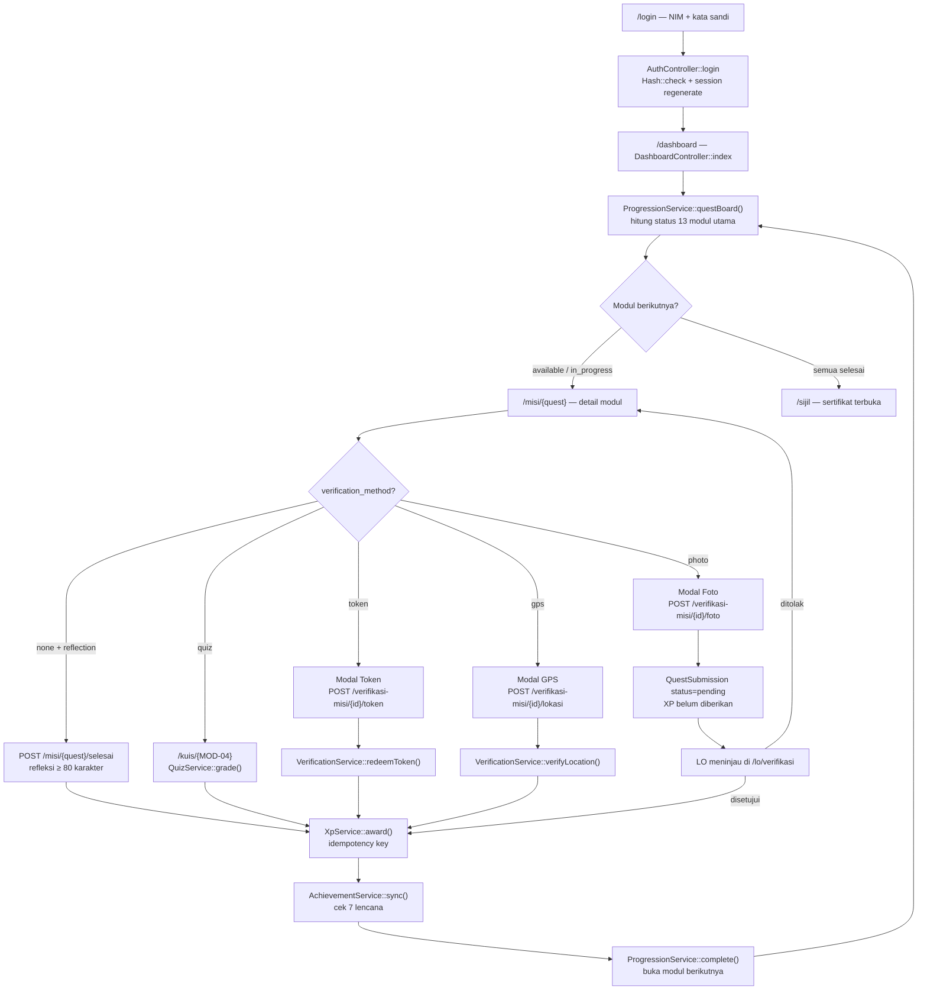
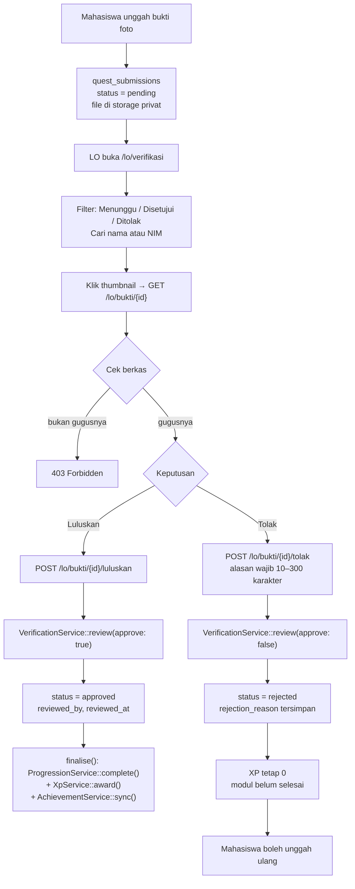
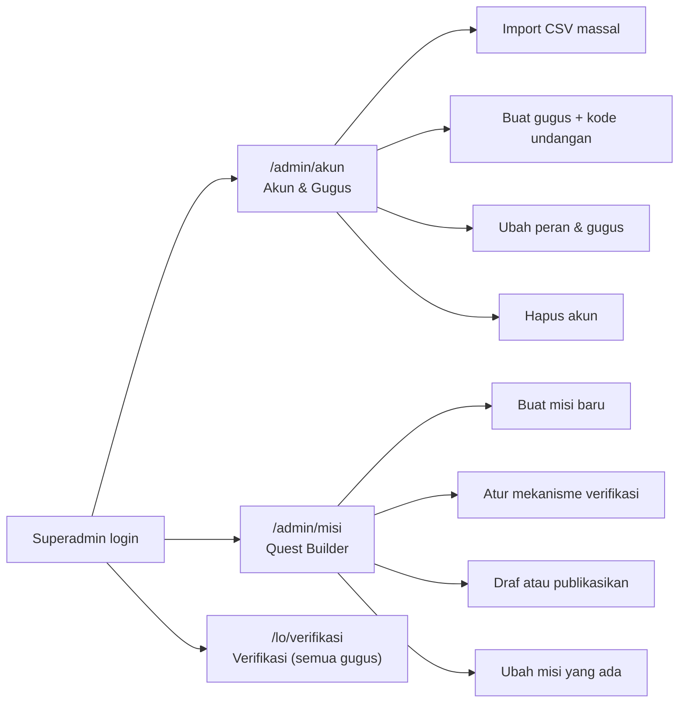
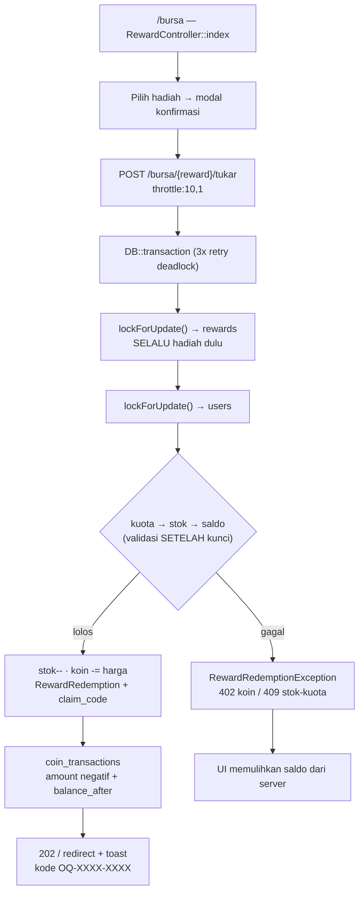
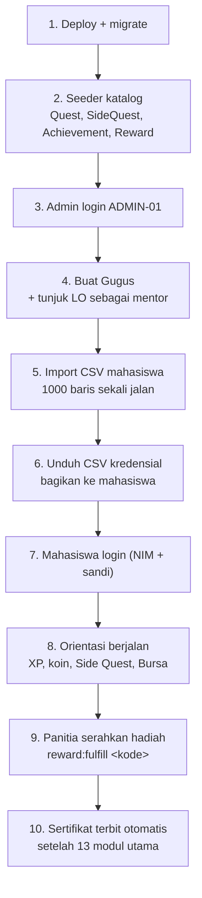

# OspekQuest — Alur Kerja Mahasiswa, LO, dan Admin

Dokumen ini menjelaskan **alur nyata** setiap peran di OspekQuest, diturunkan langsung
dari kode di `app/`, `routes/web.php`, dan `config/ospek.php`. Setiap langkah menyebut
nama class/metode yang benar-benar menjalankannya, supaya bisa ditelusuri saat presentasi
atau saat ada bug.

---

## 0. Tiga Peran, Satu Aplikasi

| Peran | Nilai `users.role` | Label UI | Masuk lewat | Halaman pertama |
|---|---|---|---|---|
| Mahasiswa baru | `student` | Mahasiswa Baru | `/login` (NIM) | `/dashboard` |
| Liaison Officer | `lo` | LO (Kakak Tingkat) | `/login` (NIM/ID) | `/dashboard` → menu **Verifikasi Bukti** |
| Superadmin | `admin` | Superadmin | `/login` (NIM/ID) | `/dashboard` → menu **Akun & Gugus**, **Quest Builder** |

> **Catatan penting:** tidak ada peran `mentor` terpisah. Metode `User::isMentor()`
> mengembalikan `true` untuk **LO dan Admin** (`UserRole::canReviewTickets()`), karena
> keduanya boleh membalas tiket bantuan. Yang membedakan LO dari Admin adalah
> `canManageAccounts()` dan `canBuildQuests()` — hanya Admin.

### Peta hak akses

| Kemampuan | Mahasiswa | LO | Admin |
|---|:--:|:--:|:--:|
| Kerjakan modul, kuis, refleksi | ✅ | — | — |
| Lihat peta misi / lencana / sertifikat / peringkat | ✅ | — | — |
| Ajukan tiket bantuan | ✅ | — | — |
| **Tinjau bukti foto** | — | ✅ gugus sendiri | ✅ semua |
| Balas tiket bantuan | — | ✅ | ✅ |
| Kelola akun & gugus (CSV, ubah peran) | — | — | ✅ |
| Buat/ubah misi (Quest Builder) | — | — | ✅ |

Ditegakkan oleh `middleware(['auth', 'role:...'])` → `App\Http\Middleware\EnsureRole`,
ditambah `abort_unless(...)` di dalam controller, dan `User::canReviewSubmissionOf()`
untuk batas per-gugus.

---

## 1. Alur Mahasiswa (Student)

### 1.1 Perjalanan dari login sampai sertifikat



### 1.2 Status modul — bagaimana ditentukan

`ProgressionService::questBoard(User $user)` menghitung status dari **tiga sumber**
sekaligus, bukan dari satu kolom yang bisa dimanipulasi:

1. **Progres tersimpan** — `user_quests.status`
2. **Urutan langkah** — `quests.step_number` (modul sebelumnya harus `completed`)
3. **Gerbang waktu** — `quests.unlock_day` ≤ hari orientasi berjalan

```php
$status = match (true) {
    $userQuest?->status === QuestStatus::Completed => QuestStatus::Completed,
    ! $quest->isUnlockedOnDay($day)               => QuestStatus::Locked,
    ! $previousCompleted                          => QuestStatus::Locked,
    $userQuest?->status === QuestStatus::InProgress => QuestStatus::InProgress,
    default                                        => QuestStatus::Available,
};
```

Empat status yang mungkin:

| Status | Arti | Alasan terkunci yang ditampilkan |
|---|---|---|
| `locked` | Belum bisa dikerjakan | "Terbuka pada hari ke-N orientasi." atau "Selesaikan modul sebelumnya terlebih dahulu." |
| `available` | Siap dimulai | — |
| `in_progress` | Sudah diklik mulai | — |
| `completed` | Selesai, XP sudah masuk | — |

**Hari orientasi** dihitung `ProgressionService::orientationDay()`:
`min(hari berjalan sejak OSPEK_START_DATE, OSPEK_TOTAL_DAYS)`.
Kalau tanggal mulai belum tiba (`orientationDay() === 0`), `effectiveDay()` mengembalikan
jumlah hari penuh — artinya **saat demo sebelum acara, semua modul terbuka** agar bisa
diperlihatkan ke juri. Setelah acara lewat, hari di-*clamp* supaya tidak muncul
"Hari ke-74 dari 8".

### 1.3 Tiga belas modul dalam tiga babak

Katalog berisi **13 modul utama** (bukan 8) yang dikelompokkan menjadi **3 babak
tematik** dari `config('ospek.chapters')`. Delapan modul tidak cukup untuk
menghasilkan 3–5 node per babak seperti yang diminta desain peta.

Data aktual dari database (`quests` setelah seeder, `is_side_quest = 0`):

| Kode | Judul | Hari | XP | Aksi | Verifikasi |
|---|---|:--:|:--:|---|---|
| **BAB 1 — Pengenalan Kampus (Hari 1–2)** |||||
| MOD-01 | Registrasi Ulang & Verifikasi Berkas | 1 | 100 | `photo_proof` | **photo** |
| MOD-02 | Jelajah Perpustakaan & Repositori Digital | 2 | 120 | `token` | **token** |
| MOD-03 | Tur Keliling Kampus & Titik Layanan | 1 | 110 | `reflection` | none |
| MOD-04 | Kuis Sistem Kredit Semester & Etika Akademik | 2 | 250 | `quiz` | none |
| **BAB 2 — Eksplorasi Fakultas (Hari 3–5)** |||||
| MOD-05 | Pertemuan Kelompok & Mentor Pendamping | 3 | 150 | `checkin` | none |
| MOD-06 | Kunjungan Laboratorium Fakultas Teknik | 3 | 180 | `token` | **token** |
| MOD-07 | Kenalan dengan Dosen Wali & Program Studi | 4 | 160 | `checkin` | none |
| MOD-08 | Apel Orientasi Akbar di Auditorium UMK | 4 | 350 | `geolocation` | **gps** |
| MOD-09 | Eksplorasi Stan Muria Computing Club (MCC) | 5 | 250 | `token` | **token** |
| **BAB 3 — Aksi & Penutupan (Hari 6–8)** |||||
| MOD-10 | Workshop Etika Digital & Jejak Online | 6 | 200 | `checkin` | none |
| MOD-11 | Proyek Mini: Solusi Digital untuk Kampus | 6 | 280 | `reflection` | none |
| MOD-12 | Presentasi Kelompok & Umpan Balik Mentor | 7 | 240 | `checkin` | none |
| MOD-13 | Upacara Penutupan & Sertifikat Orientasi | 8 | 300 | `geolocation` | **gps** |

Total XP modul utama: **2.690 XP**. Ditambah **550 XP** dari 5 Side Quest, XP
lencana (7 lencana), dan skor kuis.

> **Invariant yang dipatok tes** — jangan diubah tanpa memperbarui tesnya:
> step 3 = `Reflection`, step 4 = kuis `MOD-04` (dirujuk 15 kali di `QuizTest`),
> step 8 = GPS (`AntiCheatVerificationTest` memakainya sebagai modul jauh yang
> masih terkunci).

### 1.4 Empat jalur penyelesaian — detail teknis

#### (a) Modul biasa / refleksi — `POST /misi/{quest}/selesai`

```
QuestController::complete(CompleteQuestRequest, Quest)
  ├─ statusFor() → harus isOpen(), kalau tidak → 422 "Modul belum terbuka"
  ├─ action_type === Quiz?          → redirect ke /kuis/{module}
  ├─ requiresVerification()?        → 422 "Modul ini memerlukan verifikasi {metode}"
  ├─ action_type === Reflection?    → reflection wajib ≥ 80 karakter
  ├─ checkpointXp()                 → XP = quests.xp_reward (kecuali kuis = 0)
  ├─ ProgressionService::complete() → status completed + buka modul berikutnya
  ├─ XpService::award()             → idempotency key "quest:{user}:{quest}"
  └─ AchievementService::sync()     → buka lencana yang memenuhi syarat
```

Validasi form ada di `CompleteQuestRequest`:

```php
'reflection' => ['nullable', 'string', 'min:80', 'max:1200'],
'confirm'    => ['accepted'],   // centang konfirmasi wajib
```

#### (b) Kuis — `POST /kuis/mulai` lalu `POST /kuis/jawab`

`QuizService` memasang **tiga pengaman** yang tidak ada di versi lama:

| Pengaman | Nilai | Konsekuensi |
|---|---|---|
| Batas percobaan | `max_attempts = 3` | Percobaan ke-4 ditolak |
| Batas waktu sisi server | `time_limit_seconds = 300` + grace 20 detik | Waktu mulai diambil dari **sesi**, bukan dari body request |
| XP sekali pakai | key `quiz:{user}:{module}` | Lulus berkali-kali tetap satu award |

Alur `QuizController::start()` → `QuizService` menyimpan
`quiz.started_at.{module}` di sesi, lalu `submit()` memakai stempel itu untuk menghitung
`elapsed`. Klaim `time_taken` dari browser **tidak dipercaya**.

Penilaian: `pass_percentage = 80`. Jika lulus →
`ProgressionService::complete()` dipanggil otomatis dan XP diambil dari
**jumlah `xp_reward` per soal yang benar**, bukan dari `quests.xp_reward`.

#### (c) Token stan — `POST /verifikasi-misi/{quest}/token`

`VerificationService::redeemToken()` memeriksa berurutan:

1. `assertVerifiable()` — modul harus terbuka **dan** metodenya memang token
2. Token sudah diatur? (`hasToken()`)
3. Kedaluwarsa? (`tokenExpired()`)
4. Kuota habis? (`tokenQuotaExhausted()`)
5. Sudah pernah klaim? (`token_redemptions` per user+quest)
6. Cocok? `Hash::check(strtoupper(trim($token)), $quest->token_hash)`

Penyimpanan token memakai `Hash::make()` di `Quest::setPlainToken()`, jadi **plaintext
tidak pernah masuk database**. Penjaga terakhir adalah `insertOrIgnore()` pada tabel
`token_redemptions` dengan unique index — dua request bersamaan tetap hanya menghasilkan
satu klaim.

#### (d) GPS — `POST /verifikasi-misi/{quest}/lokasi`

```
VerificationService::verifyLocation($user, $quest, $lat, $lng, $accuracy)
  ├─ assertVerifiable()                    ← gerbang modul lebih dulu
  ├─ accuracy > 500 m?  → tolak "Sinyal GPS terlalu lemah"
  ├─ hasGeofence()?     → titik acuan harus diatur panitia
  ├─ haversineMeters()  → hitung jarak di SERVER
  └─ distance > radius? → tolak "Anda berada N m dari lokasi"
```

Akurasi diperiksa **setelah** gerbang modul — ini perbaikan bug: sebelumnya mahasiswa
menerima pesan "GPS lemah" untuk modul yang sebenarnya masih terkunci.

#### (e) Foto — `POST /verifikasi-misi/{quest}/foto`

`VerificationService::submitPhotoProof()` **tidak** menyelesaikan modul. Yang terjadi:

- Berkas disimpan di disk **privat**: `storage/app/private/proofs/{user_id}/`
- Baris `quest_submissions` dibuat dengan `status = pending`
- `user_quests` **tidak berubah**, XP **tidak** diberikan
- Pesan: "Bukti terkirim. Menunggu tinjauan LO gugus Anda."

Kalau sebelumnya sudah `pending` → ditolak ("Bukti Anda sedang menunggu tinjauan LO").
Kalau sebelumnya `rejected` → boleh unggah ulang (status kembali `pending`).

### 1.5 XP, level, lencana

**XP hanya bisa bertambah lewat satu pintu:** `XpService::award()`. Setiap award wajib
membawa `idempotencyKey`; kalau key sudah ada di `xp_transactions`, award **dilewati**.
Ini yang mencegah farming XP dengan mengulang kuis atau mengirim ulang request.

```php
$this->xp->award(
    $user, $amount, $sourceType, $sourceId, $description,
    "quest:{$user->getKey()}:{$quest->getKey()}",   // ← idempotency key
);
```

Saldo dihitung di dalam transaksi dengan `lockForUpdate()` sehingga request paralel tidak
bisa menghasilkan saldo ganda.

**Pita level** (`config/ospek.php`):

| Level | Gelar | Min XP |
|:--:|---|---:|
| 1 | Maba Pemula | 0 |
| 2 | Penjelajah Kampus | 300 |
| 3 | Pengembara Siswa | 750 |
| 4 | Perintis Kampus | 1.400 |
| 5 | Mentor Muda | 2.200 |
| 6 | Mahasiswa Legenda | 3.200 |
| 7 | Duta Orientasi | 4.500 |

**Tujuh lencana** — semuanya dihitung ulang dari data nyata oleh
`AchievementService::sync()`, bukan di-hardcode:

| Lencana | Metrik | Target | Bonus XP |
|---|---|:--:|--:|
| Langkah Pertama | `quests_completed` | 1 | +50 |
| Setengah Jalan | `quests_completed` | 4 | +150 |
| Cendekiawan Akademik | `perfect_quizzes` | 1 | +200 |
| Rentetan Konsisten | `streak_days` | 5 | +180 |
| Pemburu Poin | `total_xp` | 1.500 | +160 |
| Sahabat Mentor | `help_tickets_answered` | 1 | +120 |
| Mahasiswa Sejati | `quests_completed` | 8 | +500 |

Saat lencana pertama terbuka, mahasiswa bisa menerima **XP modul + XP lencana** sekaligus —
karena itu tes "selesaikan modul pertama" memakai `assertGreaterThanOrEqual`, bukan
kesamaan persis.

**Rentetan harian** dihitung `StreakService::touch()` yang dipanggil middleware
`TrackDailyActivity` setiap kali ada request `GET` dan `last_active_on` bukan hari ini.

### 1.6 Sertifikat

`CertificateService::isEligible()` mensyaratkan **dua** hal:

```php
return $user->orientation_completed_at !== null
    && $this->completedQuests($user) >= $this->totalQuests();
```

`orientation_completed_at` diisi otomatis oleh `ProgressionService::syncCompletionFlag()`
begitu jumlah modul selesai mencapai total. Jadi sertifikat tidak bisa dicetak dengan
progres 0/8 — ini bug versi lama yang sudah ditutup.

Kode verifikasi: `OSQ-{tahun}-{8 hex}` (contoh `OSQ-26-83AF6F3B`), bisa dicek publik di
`/verifikasi/{code}` — halaman itu hanya menampilkan keabsahan, bukan data pribadi lengkap.

### 1.7 Bantuan: tiket ke mentor

Tab **Pusat Bantuan** di `/profil?tab=helpdesk`:

1. Mahasiswa mengisi subjek, kategori, pesan → `ProfileController::submitHelpTicket()`
2. Baris `help_tickets` dibuat dengan `status = open`
3. LO/Admin membalas di `/lo/tiket` → `MentorController::reply()`, status jadi `answered`
4. Setelah dijawab, lencana **Sahabat Mentor** bisa terbuka
   (`help_tickets_answered >= 1`)

---

## 2. Alur Liaison Officer (LO)

LO adalah kakak tingkat yang mendampingi satu gugus. Batas wewenangnya **satu gugus**,
ditegakkan `User::canReviewSubmissionOf()`.

### 2.1 Membuka portal verifikasi

```
GET /lo/verifikasi → LiaisonOfficerController::index()
  ├─ abort_unless($officer->role->canVerifySubmissions(), 403)
  ├─ ambil semua user_id dengan group_id = group_id LO
  ├─ hitung statistik gugus (pending, approved, rejected, efficiency)
  └─ tampilkan antrean bukti, urut terlama dulu
```

Menu **Verifikasi Bukti** hanya muncul di sidebar bila `$navUser->isMentor()`.

### 2.2 Alur peninjauan bukti



### 2.3 Aturan yang ditegakkan `VerificationService::review()`

| Pemeriksaan | Pesan bila gagal |
|---|---|
| `$reviewer->role->canVerifySubmissions()` | "Anda tidak berwenang meninjau bukti misi." |
| `canReviewSubmissionOf($student)` | "Mahasiswa ini bukan anggota gugus Anda." |
| `status === Pending` | "Bukti ini sudah ditinjau sebelumnya." |
| Alasan wajib saat menolak | "Alasan penolakan wajib diisi agar mahasiswa tahu apa yang harus diperbaiki." |

Urutan penting: **status diubah dulu**, baru `finalise()` dipanggil di dalam
`DB::transaction` yang sama. Kalau XP gagal diberikan, seluruh perubahan di-rollback.

### 2.4 Menyajikan berkas bukti secara privat

`LiaisonOfficerController::proof()`:

```
GET /lo/bukti/{submission}
  ├─ abort_unless($officer->canReviewSubmissionOf($submission->user), 403)
  ├─ abort_if(proof_path === null, 404)
  ├─ abort_unless(Storage::disk('local')->exists(path), 404)
  └─ return Storage::disk('local')->response(path)
```

Berkas **tidak** ada di `public/`, jadi tidak bisa diakses lewat URL tebakan. Diverifikasi:
`storage/app/private/proofs/{user_id}/…` dan `find public -name "*bukti*"` → kosong.

### 2.5 Statistik yang dilihat LO

`LiaisonOfficerController::stats()` menghitung, dibatasi `group_id` LO:

| Angka | Rumus |
|---|---|
| Menunggu Verifikasi | `status = pending` dari anggota gugus |
| Disetujui | `status = approved` + jumlah hari ini |
| Ditolak | `status = rejected` |
| Rasio Kelulusan | `approved / (approved + rejected) × 100` |

### 2.6 Membalas tiket bantuan

`GET /lo/tiket` → daftar tiket semua mahasiswa (bukan hanya gugusnya), tiket `open`
diurutkan paling atas. `POST /lo/tiket/{ticket}/balas` mengisi `reply`, `answered_by`,
`answered_at`, dan status `answered`.

### 2.7 Yang **tidak** bisa dilakukan LO

- Membuka `/admin/akun` dan `/admin/misi` → **403** (diuji di `AccountManagementTest`)
- Meluluskan mahasiswa gugus lain → **403 / validation error** (diuji di `AntiCheatVerificationTest`)
- Membuat atau mengubah misi
- Mengubah peran akun

---

## 3. Alur Superadmin

### 3.1 Tiga tugas utama



### 3.2 Import massal mahasiswa — `POST /admin/akun/import`

Berkas CSV, urutan kolom **wajib**:

```
NIM, Nama Penuh, Jurusan, Email Kampus, Kode Gugus
202653900,Ayu Pramesti,Sistem Informasi,ayu@student.umk.ac.id,G-04
```

Perilaku `AccountController::bulkImport()`:

| Situasi | Yang terjadi |
|---|---|
| NIM kosong atau nama kosong | Baris dilewati, dicatat di daftar `import_skipped` |
| NIM sudah terdaftar | Baris dilewati (tidak menimpa data lama) |
| Kode gugus cocok `code`, `invitation_code`, atau `name` | Mahasiswa masuk gugus tersebut |
| Kode gugus tidak dikenal | **Dilaporkan** sebagai baris bermasalah, bukan diam-diam null |
| Kolom gugus kosong | Akun dibuat tanpa gugus (sah) |
| `auto_generate_password` dicentang | Sandi acak 10 karakter per akun |
| Tidak dicentang | Sandi awal `password` |
| Berkas bukan CSV | Ditolak validasi `mimes:csv,txt` |

Satu baris bermasalah **tidak** menggagalkan seluruh berkas — penting untuk impor 3.000
mahasiswa sekaligus. Seluruh baris valid dijalankan dalam satu `DB::transaction`.

### 3.3 Membuat gugus — `POST /admin/akun/gugus`

Isian: nama gugus, program studi, LO utama, kapasitas, warna lencana.
Efek samping yang penting:

1. `code` dibuat otomatis (`G-05`, `G-06`, …)
2. `invitation_code` diacak (`KELOMP-0C23`)
3. **LO otomatis dipindahkan ke gugus itu** (`$mentor->forceFill(['group_id' => ...])`)
   — tanpa ini LO tidak bisa meninjau bukti gugus yang ia bimbing

Validasi: nama unik, `mentor_id` harus benar-benar berperan `lo` (bukan mahasiswa).

### 3.4 Ubah peran & hapus akun

- `POST /admin/akun/{user}/peran` — ubah `role` + `group_id`
- `DELETE /admin/akun/{user}` — hapus akun

Dua pagar pengaman:

| Pagar | Alasan |
|---|---|
| Admin tidak bisa menurunkan peran sendiri | Mencegah terkunci di luar panel |
| Admin tidak bisa menghapus akun sendiri | Sama |

### 3.5 Quest Builder — `GET/POST /admin/misi`

Form empat bagian: informasi dasar, target sasaran, kolaborasi UKM, mekanisme verifikasi.
Panel kanan menampilkan **pratinjau live** kartu misi seperti yang dilihat mahasiswa.

**Validasi silang** di `QuestBuilderController::validated()` — ini yang mencegah modul
mustahil diselesaikan:

| Metode verifikasi | Syarat wajib |
|---|---|
| `token` | `token_code` wajib (kecuali sudah ada hash lama) |
| `gps` | `latitude` dan `longitude` wajib |
| `photo` | tidak ada syarat tambahan |
| `none` | tidak ada syarat tambahan |

Aturan lain:

- `step_number` **harus unik** → menentukan kode `MOD-xx`. Tanpa aturan ini dua modul
  mendapat kode sama dan meledak sebagai `SQLSTATE[23000]` di tingkat database.
- Kode kuis ikut di-*pad*: `MOD-09`, bukan `MOD-9`.
- Saat mengubah misi, kode modul ikut berubah mengikuti urutan baru — **kecuali** modul
  kuis yang sudah punya percobaan, agar riwayat `quiz_attempts` tidak yatim.
- Token disimpan sebagai hash; plaintext tidak pernah menyentuh database.

Tombol ganda: **Simpan Draf** (`status = draft`, tidak tampil ke mahasiswa) dan
**Simpan & Publikasikan** (`status = published`).

### 3.6 Verifikasi lintas gugus

Admin boleh membuka `/lo/verifikasi` dan meninjau bukti **semua** gugus, karena
`User::canReviewSubmissionOf()` mengembalikan `true` lebih awal untuk admin.

---

## 4. Bursa Hadiah — koin terpisah dari XP

Bursa Hadiah memisahkan dua mata uang yang sering keliru disatukan:

| | XP | Koin |
|---|---|---|
| Fungsi | reputasi & progres | alat belanja |
| Arah | **hanya bertambah** | bisa naik dan turun |
| Menentukan | level, gelar, papan peringkat | hadiah di Bursa |
| Ledger | `xp_transactions` | `coin_transactions` |

> Kalau XP dipakai langsung sebagai alat tukar, mahasiswa bisa menukar lencananya
> sendiri lalu **turun level** — dan papan peringkat kehilangan makna.

**Alur penukaran** (`RewardService::redeemReward()`):



**Kenapa urutannya begini** — empat keputusan yang tidak boleh ditukar:

1. **Kunci selalu reward lalu user.** Urutan konsisten mencegah dua transaksi
   saling menunggu secara melingkar (deadlock).
2. **Validasi setelah kunci didapat.** Memeriksa stok sebelum mengunci *adalah*
   race condition-nya — dua proses bisa sama-sama melihat sisa 1.
3. **`stock = NULL` berarti tak terbatas dan tidak pernah didekrementasi.**
   `NULL - 1` menghasilkan `NULL`, yang menghapus maknanya diam-diam.
4. **`stock` global dipisah dari `quota_per_user`.** Tanpa itu satu mahasiswa
   bisa menyapu seluruh stok.

**Bukti penguncian.** 40 proses PHP paralel di MySQL berebut hadiah berstok 5:
tepat **5 berhasil, 35 ditolak `out_of_stock`**, stok akhir 0 (bukan negatif),
koin terpakai pas 500. Kontrol pembanding **tanpa** `lockForUpdate()` menghasilkan
**7 klaim dari stok 5** — membuktikan penguncian yang mencegahnya, bukan kebetulan.

**Penyerahan di meja panitia:**

```bash
php artisan reward:fulfill OQ-QRRF-Z6UT                             # tandai sudah diambil
php artisan reward:fulfill OQ-QRRF-Z6UT --cancel --reason="..."     # batalkan + refund
```

Klaim berstatus `fulfilled` **tidak bisa** dibatalkan. Tanpa aturan ini, mahasiswa
bisa di-refund untuk barang yang sudah dibawa pulang.

---

## 5. Side Quest — misi sosial opsional

Diminta eksplisit oleh proposal (Manfaat & Tujuan poin 3: *"berinteraksi secara
sosial melalui fitur Side Quest"*). Berbeda dari modul utama dalam tiga hal,
dan ketiganya disengaja:

1. **Tidak masuk rantai prasyarat** — melewatkannya tidak mengunci apa pun.
2. **Tidak dihitung gerbang babak** — peta tetap 13 node / 3 babak.
3. **Gerbangnya progres modul utama**, bukan hari.

| Kode | Judul | Terbuka setelah |
|---|---|:--:|
| SQ-01 | Sapa Lima Teman Baru | 0 modul |
| SQ-02 | Foto Bareng Gugus | 2 modul |
| SQ-03 | Bantu Satu Mahasiswa Baru | 4 modul |
| SQ-04 | Tantang Dosen Satu Pertanyaan | 6 modul |
| SQ-05 | Rekam Pesan untuk Diri Sendiri | 8 modul |

> **Jebakan yang sudah dibayar:** menambahkan entitas opsional ke sistem yang
> *menghitung* hal membongkar enam query. Yang paling parah,
> `syncCompletionFlag()` memakai `Quest::count()` termasuk Side Quest sehingga
> **sertifikat tidak akan pernah terbit**. Semua query kini memakai scope
> `mainline()`. Kalau menambah entitas opsional lagi, sisir setiap
> `Quest::query()->count()`.

---

## 6. Titik Temu Antar Peran

| Kejadian | Mahasiswa | LO | Admin |
|---|---|---|---|
| Unggah bukti foto | status `pending`, XP 0 | melihat di antrean | melihat semua gugus |
| Bukti disetujui | XP masuk, modul selesai, modul berikutnya terbuka | statistik "Disetujui" naik | — |
| Bukti ditolak | pesan alasan tampil, boleh unggah ulang | statistik "Ditolak" naik | — |
| Tiket dibuat | status `open` | membalas | membalas |
| Tiket dijawab | lencana "Sahabat Mentor" bisa terbuka | — | — |
| Akun dibuat admin | bisa login | mahasiswa masuk gugusnya | — |
| Misi baru dipublikasikan | muncul di peta misi | — | membuatnya |

---

## 7. Lima hook engagement di dasbor

Dimasukkan agar dasbor tidak menjadi daftar 13 misi yang memicu *cognitive
overload*. Tiga widget pertama menyusun **Fokus Harian**; dua sisanya menambah
lapisan kompetisi.

| Fitur | Dipicu oleh | Sumber data | Bisa di-farm? |
|---|---|---|---|
| **Fokus Hari Ini** | buka `/dashboard` | `ProgressionService::todayFocus()` | — |
| **Misi Selanjutnya** | buka `/dashboard` | `nextUp($user, 3)` | — |
| **Tantangan Harian** | buka `/dashboard` | `user_quests` + `xp_transactions` hari ini | — |
| **Gugus Wars** | buka `/dashboard` | `groupStandings()` | Tidak: rasio dari server |
| **Kotak Misteri** | auto-buka 900 ms setelah muat | `engagement_claims` | Tidak: deterministik per user+tanggal |
| **Digital Flexing** | buka `/peringkat` | `titleFor($user, $rank)` | Tidak: dari XP nyata |
| **FOMO Live Feed** | rotasi tiap 9 detik | `xp_transactions` orang lain | Tidak: data asli |
| **Misi Rahasia** | 7 ketukan cepat pada Wira | `engagement_claims` (`period='once'`) | Tidak: sekali seumur akun |

**Tiga lapis penahan hadiah palsu:**

1. `throttle:20,1` pada grup `/misi-seru`
2. `unique(user_id, kind, period)` di `engagement_claims`
3. `idempotency_key` di `XpService::award()`

Klien hanya mengirim **peristiwa** ("saya klik"), tidak pernah jumlah XP. Terbukti
di uji: klaim kedua menghasilkan `{"xp":0,"already":true}` dan saldo tidak bergerak.

> **Dua bug yang tertangkap saat pengujian**, bukan saat menulis kode:
> penanda kotak harian dulu hanya berisi tanggal sehingga mahasiswa berikutnya di
> lab kampus yang sama tidak pernah melihat kotaknya sendiri; dan modal
> `aria-modal="true"` tidak memindahkan fokus sehingga pengguna keyboard tetap
> menjelajah halaman di belakang modal.

---

## 8. Yang Menjaga Semua Ini Tetap Jujur

Delapan aturan yang ditegakkan **di server**, bukan di JavaScript:

1. **Modul terkunci tidak bisa diselesaikan** — status dihitung ulang setiap request
   (`ProgressionService::statusFor()`), bukan dibaca dari kolom yang bisa diubah.
2. **XP idempoten** — setiap award membawa `idempotency_key` unik di `xp_transactions`.
3. **Token sekali pakai per akun**, dengan kuota dan kedaluwarsa.
4. **Radius GPS dihitung di server** dengan formula haversine; akurasi > 500 m ditolak.
5. **Bukti foto tidak memberi XP** sampai LO gugus menyetujui.
6. **LO hanya bisa meninjau gugusnya** — URL yang dimanipulasi tetap 403.
7. **Berkas bukti disimpan privat** dan disajikan lewat rute ber-otorisasi.
8. **Kuis memakai timer sisi server**; waktu mulai diambil dari sesi, bukan body request.

Permukaan verifikasi juga dibatasi rate limit: `throttle:12,1` pada semua rute
`/verifikasi-misi/*`, dan `throttle:6,1` pada `POST /login`.

---

## 9. Peta Rute per Peran

### Mahasiswa (middleware `auth`, `activity`)

| Method | Rute | Nama | Controller |
|---|---|---|---|
| GET | `/dashboard` | `dashboard` | `DashboardController@index` |
| GET | `/misi` | `quests.index` | `QuestController@index` |
| GET | `/misi/{quest}` | `quests.show` | `QuestController@show` |
| POST | `/misi/{quest}/mulai` | `quests.start` | `QuestController@start` |
| POST | `/misi/{quest}/selesai` | `quests.complete` | `QuestController@complete` |
| POST | `/verifikasi-misi/{quest}/token` | `verify.token` | `VerificationController@token` |
| POST | `/verifikasi-misi/{quest}/lokasi` | `verify.location` | `VerificationController@location` |
| POST | `/verifikasi-misi/{quest}/foto` | `verify.photo` | `VerificationController@photo` |
| GET | `/kuis/{module?}` | `quiz` | `QuizController@index` |
| POST | `/kuis/mulai` | `quiz.start` | `QuizController@start` |
| POST | `/kuis/jawab` | `quiz.submit` | `QuizController@submit` |
| GET | `/pencapaian` | `achievements` | `AchievementController@index` |
| GET | `/sijil` | `certificate` | `CertificateController@show` |
| GET | `/peringkat` | `leaderboard` | `LeaderboardController@index` |
| GET/POST | `/profil` | `profile` / `profile.update` | `ProfileController` |
| POST | `/bantuan/tiket` | `help.ticket` | `ProfileController@submitHelpTicket` |

### LO (middleware `auth`, `role:lo,admin`)

| Method | Rute | Nama | Controller |
|---|---|---|---|
| GET | `/lo/verifikasi` | `lo.dashboard` | `LiaisonOfficerController@index` |
| GET | `/lo/bukti/{submission}` | `lo.proof` | `LiaisonOfficerController@proof` |
| POST | `/lo/bukti/{submission}/luluskan` | `lo.approve` | `LiaisonOfficerController@approve` |
| POST | `/lo/bukti/{submission}/tolak` | `lo.reject` | `LiaisonOfficerController@reject` |
| GET | `/lo/tiket` | `lo.tickets` | `MentorController@tickets` |
| POST | `/lo/tiket/{ticket}/balas` | `lo.tickets.reply` | `MentorController@reply` |

### Admin (middleware `auth`, `role:admin`)

| Method | Rute | Nama | Controller |
|---|---|---|---|
| GET | `/admin/akun` | `admin.accounts` | `AccountController@index` |
| POST | `/admin/akun/import` | `admin.accounts.import` | `AccountController@bulkImport` |
| GET | `/admin/akun/template` | `admin.accounts.template` | `AccountController@template` |
| POST | `/admin/akun/{user}/peran` | `admin.accounts.role` | `AccountController@updateRole` |
| DELETE | `/admin/akun/{user}` | `admin.accounts.destroy` | `AccountController@destroy` |
| POST | `/admin/akun/gugus` | `admin.groups.store` | `AccountController@storeGroup` |
| GET | `/admin/misi` | `admin.quests.index` | `QuestBuilderController@index` |
| POST | `/admin/misi` | `admin.quests.store` | `QuestBuilderController@store` |
| PUT | `/admin/misi/{quest}` | `admin.quests.update` | `QuestBuilderController@update` |

### Publik

| Method | Rute | Nama | Controller |
|---|---|---|---|
| GET | `/login` | `login` | `AuthController@showLogin` |
| POST | `/login` | `login.post` | `AuthController@login` (`throttle:6,1`) |
| POST | `/logout` | `logout` | `AuthController@logout` |
| GET | `/verifikasi/{code?}` | `certificate.verify` | `CertificateController@verify` |

---

## 10. Deployment — kebutuhan runtime nyata

Aplikasi ini **tidak statis**. Yang wajib ada di server:

| Kebutuhan | Dipakai untuk | Catatan |
|---|---|---|
| PHP ≥ 8.3 | seluruh aplikasi | `composer.json` mensyaratkan `^8.3` |
| MySQL / MariaDB | data utama | SQLite jalan untuk lokal, **tidak aman** untuk multi-user |
| Filesystem writable | `storage/` (bukti foto, sesi) | harus persisten antar-request |
| `SESSION_DRIVER=database` | login | butuh tabel `sessions` |
| `CACHE_STORE=database` | cache | butuh tabel `cache` |
| `QUEUE_CONNECTION=database` | antrean | **tidak ada job yang di-dispatch**, jadi worker tidak wajib |

**Yang tidak dibutuhkan:** Redis, queue worker, cron/scheduler (tidak ada
`Schedule::` di kode), WebSocket. Ini membuat aplikasi bisa jalan di paket gratis
yang paling sederhana sekalipun.

### Wasmer: build gagal karena PHP 8.3 (bukan 8.4)

Gejala yang terlihat di log:

```
In Request.php line 117:
  syntax error, unexpected token "{", expecting "," or ";"
```

Baris itu adalah **property hooks** — fitur PHP **8.4**:

```php
public ParameterBag $attributes {
    set { ... }
}
```

Log build sendiri menyebutkan penyebabnya di baris kedua:

```
PHP version: 8.3.29
```

**Rantai sebabnya:**

| Lapisan | Nilai | Akibat |
|---|---|---|
| `composer.json` `require.php` | `^8.4` | butuh PHP ≥ 8.4 |
| `symfony/*` v8.1.10 | `php >=8.4.1` | memakai sintaks 8.4 |
| Wasmer `phpix` | **8.3.29** | tidak bisa mem-parse file |
| `--ignore-platform-reqs` | aktif | Composer **tidak** memeriksa, jadi lolos build lalu meledak saat runtime |

Baris terakhir itu kuncinya: `composer install --ignore-platform-reqs` mematikan
satu-satunya penjaga yang bisa menangkap ketidakcocokan ini lebih awal.

**Yang sudah diperbaiki di repo:**

1. `config.platform.php = 8.4.4` — Composer menyelesaikan dependensi untuk
   PHP 8.4 walau dijalankan di mesin lain, sehingga lock file tidak bisa
   "diam-diam" dipenuhi paket yang salah platform.
2. Script `check:php` — gagal cepat dengan pesan jelas alih-alih `syntax error`
   yang membingungkan:
   ```
   [FATAL] OspekQuest butuh PHP >= 8.4, yang terpasang 8.3.29
   ```
3. Script `build:production` — `--no-dev` + `npm ci`, karena paket dev
   (phpunit, boost, pail) tidak diperlukan di produksi dan hanya memperlambat build.

**Yang tetap harus Anda lakukan di sisi Wasmer:** pilih PHP **8.4** sebagai
runtime. Selama platform masih 8.3, build akan tetap gagal — dan kegagalannya
kini jelas menyebut versi, bukan `syntax error` di file vendor.

Kalau Wasmer belum menyediakan PHP 8.4, dua jalan keluarnya:

| Jalan | Konsekuensi |
|---|---|
| Turunkan `symfony/*` ke v7.x (`composer require symfony/http-foundation:^7.4 -W`) | Laravel 13 resmi mendukung Symfony 7.4 — berjalan di PHP 8.3, tapi Anda kehilangan fitur 8.4 |
| Pindah ke platform yang mendukung PHP 8.4 (VPS kampus, Koyeb via Dockerfile) | Tidak ada perubahan kode |

**Untuk lomba, hindari menurunkan dependensi** — itu mengubah fondasi proyek
hanya demi satu platform. PHP 8.4 adalah versi stabil saat ini dan tersedia di
hampir semua VPS modern.

### Kenapa Vercel tidak cocok

Vercel menjalankan PHP sebagai **serverless function**: filesystem-nya read-only
dan instance-nya berumur pendek. Tiga hal di aplikasi ini bentrok langsung:

1. **Upload bukti foto** ditulis ke `storage/app/` — hilang setiap instance dibuang.
2. **Sesi berbasis database** butuh koneksi MySQL persisten; serverless membuka
   koneksi baru tiap request dan menghabiskan kuota pooler.
3. **`php artisan migrate`/`db:seed`** tidak punya tempat jalan yang wajar.

Secara teori bisa dipaksakan (runtime `vercel-community/php` + Postgres eksternal +
S3), tetapi itu menambah tiga dependensi baru hanya untuk mengejar platform yang
salah bentuk. Untuk karya lomba, risikonya tidak sepadan.

### Kalau akun trial sudah habis (kasus Anda)

Railway free plan butuh verifikasi akun GitHub yang aktif. Kalau trial sudah
_expired_, jangan mengikat diri ke platform yang menuntut verifikasi ulang.
Urutan ini dipilih karena **tidak butuh trial, tidak butuh kartu, dan tidak tidur
saat dinilai**:

| Prioritas | Opsi | Kenapa | Batasan |
|:--:|---|---|---|
| 1 | **VPS kampus / lab** | gratis, tidak tidur, kontrol penuh, IP sendiri | Anda urus Nginx + SSL |
| 2 | **GitHub Student Pack → DigitalOcean $200** | kredit 1 tahun, droplet 1 GB cukup | perlu verifikasi status mahasiswa (KTM) |
| 3 | **InfinityFree** | gratis selamanya, PHP + MySQL, tanpa kartu | tanpa SSH, tanpa queue, performa terbatas |
| 4 | **Koyeb** | 1 web service 512 MB, tanpa kartu | perlu Dockerfile |
| 5 | **Laravel Cloud** | paling mulus untuk Laravel | $5 kredit, bulan pertama saja |

> **Untuk lomba, VPS kampus adalah pilihan teraman.** Ia tidak akan spin-down
> atau kehabisan kredit tepat saat juri membuka tautan — kegagalan yang paling
> memalukan dan paling mudah dihindari.

**Kalau memilih InfinityFree** (paling cepat, tanpa urus server): unggah lewat
FTP, arahkan document root ke `public/`, lalu sesuaikan `APP_URL` dan
`DB_*` dari panel. Tidak ada `php artisan` lewat SSH, jadi jalankan migrasi
**sebelum** unggah — ekspor database lokal, impor lewat phpMyAdmin.

### Pilihan yang realistis (semua tanpa kartu kredit)

| Opsi | Gratis? | Cocok untuk OspekQuest | Catatan |
|---|---|---|---|
| **Laravel Cloud** | $5 kredit, 1 bulan pertama | ⭐ paling mulus | dibuat untuk Laravel; bisa scale-to-zero |
| **Railway** | $1/bulan kredit tetap | ⭐ bagus | cukup untuk 1 app + MySQL kecil |
| **Koyeb** | 1 web service, 512 MB | ✅ | butuh Dockerfile |
| **Render** | 750 jam/bulan | ⚠️ | **tidur setelah 15 menit**; DB gratis berumur 30 hari |
| **InfinityFree** | selamanya | ⚠️ | tanpa SSH, tanpa queue, performa terbatas |
| **VPS kampus / GitHub Student** | gratis untuk mahasiswa | ⭐ | kontrol penuh, tapi Anda urus server sendiri |

> **Rekomendasi untuk lomba:** Laravel Cloud atau Railway. Untuk juri, yang
> penting adalah **tautan bisa dibuka dan responsif saat dinilai** — bukan
> arsitekturnya. Hindari Render free karena spin-down 15 menit membuat klik
> pertama terasa lambat tepat saat juri mencoba.

### Checklist sebelum publik

- [ ] `APP_ENV=production`, `APP_DEBUG=false`
- [ ] `OSPEK_DEMO_LOGIN=false` — kalau tidak, siapa pun bisa masuk sebagai akun demo
- [ ] `php artisan migrate --force` + `php artisan db:seed --class=QuestSeeder` (+ SideQuest, Reward, Achievement)
- [ ] `php artisan storage:link` untuk bukti foto
- [ ] `php artisan config:cache route:cache view:cache`
- [ ] Ganti `APP_KEY` produksi dan sandi akun demo

---

## 10.1 Flow produksi — dari hari nol sampai hari pertama

**Tidak ada registrasi mandiri.** Rute `/register` tidak ada, dan `AuthController::login()`
hanya mencocokkan `nim` atau `email` yang **sudah ada di database**. Artinya urutan
produksi bersifat wajib, bukan pilihan:



### Urutan yang tidak boleh dibalik

| # | Langkah | Kenapa harus di urutan ini |
|---|---|---|
| 1 | `php artisan migrate --force` | Tabel harus ada sebelum apa pun |
| 2 | `db:seed` (katalog) | Tanpa katalog, peta kosong dan Bursa tidak punya hadiah |
| 3 | Login admin | Hanya admin yang bisa membuat gugus & import |
| 4 | **Buat gugus dulu** | CSV merujuk kolom "Kode Gugus"; kode tak dikenal → baris dilewati |
| 5 | Import CSV mahasiswa | Membuat akun + menempelkan ke gugus |
| 6 | **Unduh kredensial** | Sandi hanya tampil **sekali** di halaman admin |
| 7 | Mahasiswa login | Setelah ini normal |

**Kenapa gugus sebelum import:** `bulkImport()` mencocokkan kolom "Kode Gugus"
dengan `invitation_code`, `code`, atau `name`. Kalau gugusnya belum ada, baris itu
dilewati dan dilaporkan sebagai "gugus tidak ditemukan" — mahasiswa tetap dibuat
tetapi tanpa gugus, yang merusak Gugus Wars dan batas wewenang LO.

**Kenapa kredensial wajib diunduh:** tidak ada fitur "lupa sandi" dan tidak ada
email reset. Kalau CSV kredensial hilang, satu-satunya pemulihan adalah lewat
database:

```bash
php artisan tinker --execute="
App\Models\User::where('nim','202653033')
  ->first()->forceFill(['password'=>bcrypt('sandi-baru')])->save();"
```

Untuk 1000 mahasiswa, kehilangan CSV berarti kerja manual berhari-hari. **Unduh
dan simpan sebelum menutup halaman import.**

### Template CSV

Header wajib, urutan kolom tetap:

```csv
NIM,Nama,Jurusan,Email,Kode Gugus
202654001,Siti Aminah,Sistem Informasi,siti@student.umk.ac.id,GARUDA-A1B2
202654002,Budi Hartono,Informatika,,MERpati-C3D4
```

- **Email boleh kosong** → otomatis `<NIM>@students.umk.ac.id`
- **Jurusan kosong** → "Sistem Informasi"
- **NIM duplikat** → baris dilewati, batch tetap lanjut
- Maksimal **25 MB** per unggahan

Template siap unduh tersedia di `/admin/akun/template`.

#### Dataset yang tersedia (`database/data/`)

| Berkas | Isi | Untuk apa |
|---|---|---|
| `mahasiswa-umk-1000.csv` | **1210 mahasiswa, 6 fakultas, 16 prodi** | dataset produksi / demo penuh |
| `mahasiswa-umk-contoh-10.csv` | 10 baris, satu per fakultas | uji cepat sebelum unggah penuh |
| `mahasiswa-umk-contoh-cacat.csv` | 7 baris, **6 cacat disengaja** | membuktikan laporan "baris dilewati" bekerja |
| `generate-students.py` | generator deterministik | membuat ulang ketiga berkas di atas |
| `mahasiswa-umk-ft-1000.csv` | varian khusus **Fakultas Teknik** saja (5 prodi) | demo terfokus prodi sendiri |
| `mahasiswa-ospekquest-*.csv` | dataset lama (2 prodi, NIM bentrok) | arsip — jangan dipakai lagi |

**OspekQuest dipakai satu universitas, bukan satu fakultas.** Dataset utama
mencakup 6 fakultas dan 16 program studi S1 (sumber: PMB UMK):

| Fakultas | Prodi | NIM | Jml |
|---|---|---|:--:|
| Ekonomi dan Bisnis | Manajemen | `202611201..` | 130 |
| Ekonomi dan Bisnis | Akuntansi | `202612201..` | 90 |
| Hukum | Ilmu Hukum | `202621201..` | 70 |
| Keguruan dan Ilmu Pendidikan | Pendidikan Guru Sekolah Dasar | `202631201..` | 120 |
| Keguruan dan Ilmu Pendidikan | Bimbingan dan Konseling | `202632201..` | 85 |
| Keguruan dan Ilmu Pendidikan | Pendidikan Bahasa Inggris | `202633201..` | 75 |
| Keguruan dan Ilmu Pendidikan | Pendidikan Bahasa dan Sastra Indonesia | `202634201..` | 55 |
| Keguruan dan Ilmu Pendidikan | Pendidikan Matematika | `202635201..` | 50 |
| Pertanian | Agroteknologi | `202641201..` | 60 |
| Pertanian | Agribisnis | `202642201..` | 55 |
| Teknik | Teknik Informatika | `202651201..` | 100 |
| Teknik | Sistem Informasi | `202652201..` | 90 |
| Teknik | Teknik Mesin | `202653201..` | 60 |
| Teknik | Teknik Elektro | `202654201..` | 50 |
| Teknik | Teknik Industri | `202655201..` | 55 |
| Psikologi | Psikologi | `202661201..` | 65 |
| | **Total** | | **1210** |

Jumlah per prodi **sengaja tidak rata** — Manajemen dan PGSD memang lebih besar,
seperti kampus sungguhan. Sebaran gugus 302–303 orang.

Pemetaan jurusan → fakultas ada di `config('ospek.faculties')` dan dipakai
`bulkImport()`; kolom `faculty` tidak lagi di-hardcode "Fakultas Teknik".

Kenapa NIM mulai dari **201**, bukan 001: seeder sudah memakai NIM `202653012`,
`202653033`, `202653044`, `202653055`, `202653067`, `202653078`, dan `202653101`
untuk akun demo. Rentang yang bertabrakan akan membuat import melewati baris itu
sebagai "sudah terdaftar".

Berkas ini menghasilkan **211 email kosong** untuk menguji fallback
`<NIM>@students.umk.ac.id`.

Diuji otomatis oleh `StudentDatasetImportTest`: 1210 baris masuk tanpa satu pun
dilewati, 6 fakultas dengan jumlah tepat, dan **setiap prodi menempel ke fakultas
yang benar** (16 prodi diperiksa satu per satu).


### Peran yang harus disiapkan lebih dulu

Sebelum import massal, pastikan sudah ada:

1. **1 Superadmin** — dari seeder (`ADMIN-01`), atau buat manual lalu **ganti sandinya**
2. **4 LO** — karena `storeGroup()` mewajibkan `mentor_id` menunjuk user berperan LO
3. **Gugus** — minimal 1 per kelompok orientasi

> Urutan ini nyata, bukan teoretis: `test_group_requires_an_actual_liaison_officer_as_mentor`
> memastikan gugus **tidak bisa** dibuat tanpa LO sungguhan.

### Hal yang harus dimatikan sebelum publik

| Setelan | Nilai produksi | Risiko kalau lupa |
|---|---|---|
| `APP_DEBUG` | `false` | Stack trace + kredensial DB bocor ke peramban |
| `OSPEK_DEMO_LOGIN` | `false` | Siapa pun masuk sebagai akun demo = ambil alih XP |
| `APP_ENV` | `production` | Halaman error menampilkan detail internal |
| Sandi akun demo | diganti | `202653033`/`password` bisa dipakai siapa saja |

---

## 11. Berkas yang Perlu Dibuka Saat Presentasi

| Kalau juri bertanya… | Buka file ini |
|---|---|
| "Bagaimana status modul ditentukan?" | `app/Services/ProgressionService.php` |
| "Bagaimana mencegah curang?" | `app/Services/VerificationService.php` |
| "Bagaimana XP tidak bisa di-farm?" | `app/Services/XpService.php` |
| "Bagaimana penilaian kuis?" | `app/Services/QuizService.php` |
| "Bagaimana lencana terbuka?" | `app/Services/AchievementService.php` |
| "Kenapa sertifikat tidak bisa dipalsukan?" | `app/Services/CertificateService.php` |
| "Apa saja rutenya?" | `routes/web.php` (129 baris) |
| "Apa saja aturan bisnisnya?" | `config/ospek.php` |

---

## 12. Akun Demo untuk Demonstrasi

Semua bersandi `password`. Kolom gugus di bawah adalah penempatan **setelah**
`groups:rebuild` (satu gugus = satu program studi), bukan nama gugus lama.

| Peran | ID | Nama | Jurusan | Gugus |
|---|---|---|---|---|
| Mahasiswa | `202653033` | Aldiansyah Fayruz | Sistem Informasi | Sistem Informasi 2 |
| Mahasiswa | `202653044` | Muhammad Viza Fairuzzeka | Sistem Informasi | Sistem Informasi 2 |
| Mahasiswa | `202653012` | Aisyah Nur Fadhilah | Sistem Informasi | Sistem Informasi 2 |
| Mahasiswa | `202653067` | Vicko Amelino Syahputra | Sistem Informasi | Sistem Informasi 3 |
| Mahasiswa | `202653101` | Citra Ayu Lestari | Sistem Informasi | Sistem Informasi 3 |
| Mahasiswa | `202653078` | Bagas Dwi Prasetyo | Informatika | Informatika 1 |
| Mahasiswa | `202653055` | Dimas Arya Saputra | Informatika | Informatika 1 |
| LO | `LO-2022-001` | Kak Nissa | Sistem Informasi | Sistem Informasi 1 |
| LO | `LO-2022-002` | Kak Syakirah | Sistem Informasi | Sistem Informasi 1 |
| LO | `LO-2022-003` | Kak Dimas | Sistem Informasi | Sistem Informasi 1 |
| LO | `LO-2022-004` | Kak Rahul | Informatika | Informatika 1 |
| Admin | `ADMIN-01` | Dr. Rian Ardianto | Sistem Informasi | — (admin tidak bergugus) |

Pasangan untuk menguji batas wewenang LO: `202653033` (Sistem Informasi 2)
sebagai mahasiswa, `LO-2022-001` sebagai LO yang **berhak**, dan `LO-2022-004`
(Informatika) sebagai LO yang harus **ditolak** karena beda jurusan.

### Sandi akun LO hasil `lo:generate`

`lo:generate` membuat sandi **acak** per akun dan menampilkannya sekali. Untuk
demo, seragamkan dulu:

```bash
php artisan demo:passwords --role=lo          # semua LO -> "password"
php artisan demo:passwords --role=all --password=demo123
```

Perintah ini menolak berjalan di `APP_ENV=production` tanpa `--force`, karena
menyeragamkan sandi di server nyata sama dengan membuka semua akun.

**Untuk orientasi sungguhan:** ganti LO uji ini dengan LO asli sebelum hari-H.
Akun uji mudah dikenali — nama berawalan `LO ` dan email `@lo.umk.ac.id`.

## 13. Skrip video demo (target 3 menit)

Juri menilai **apa yang mereka lihat dan ingat**, bukan berapa banyak fitur.
Video yang menang adalah yang punya satu kalimat posisi yang jelas, tiga momen
"oh" yang tak terduga, dan bukti kejujuran sistem.

**Kalimat posisi (ucapkan di 15 detik pertama):**
> "OSPEK biasanya berupa PDF dan grup WhatsApp. OspekQuest mengubahnya menjadi
> peta misi yang membuat mahasiswa baru *ingin* menyelesaikannya — dan panitia
> bisa membuktikan setiap misi benar-benar dikerjakan."

#### Struktur waktu

| Detik | Adegan | Yang harus terlihat | Kalimat kunci |
|---|---|---|---|
| 0–12 | Hook masalah | PDF rundown kusam → transisi keras ke peta misi neo-brutalist | kalimat posisi di atas |
| 12–35 | **Peta Misi** | scroll kurva S, 3 babak, label mengambang, Wira | "13 modul, 3 babak, satu perjalanan" |
| 35–60 | **Fokus Harian** | dasbor: Fokus Hari Ini, 3 misi terdekat, CTA | "tidak ada 13 tugas sekaligus — hanya hari ini" |
| 60–85 | **Bukti jujur** | MOD-01 foto → XP **belum** naik → LO setujui → XP naik | "XP tidak diberikan karena mengklaim selesai" |
| 85–105 | **Gugus Wars** | tali tertarik saat satu modul selesai | "kompetisi antargugus, bukan antar-individu" |
| 105–130 | **Bursa Hadiah** | koin 1.200 → tukar lanyard → kode klaim | "XP tidak bisa dipakai belanja — jadi peringkat tetap bermakna" |
| 130–150 | **Side Quest** | 5 misi sosial, gerbang progres | "mahasiswa baru saling mengenal, bukan hanya klik" |
| 150–165 | **Anti-curang** | kirim token sama 2× → ditolak; akses LO gugus lain → 403 | "setiap klaim bisa diaudit" |
| 165–180 | Penutup | sertifikat + angka | "147 tes otomatis, 0 bug terbuka" |

#### Tiga momen "oh" yang harus dipertahankan

1. **XP tidak naik setelah unggah bukti.** Juri mengira tombol selesai langsung
   memberi XP. Justru menahannya yang membuktikan sistemnya serius.
2. **Gugus Wars bergerak saat satu modul selesai.** Perubahan visual instan jauh
   lebih meyakinkan daripada tabel angka.
3. **Kotak Misteri meledak dengan confetti** lalu menolak dibuka kedua kali.
   Ini menunjukkan gamifikasi *dan* integritas dalam satu adegan.

#### Aturan produksi

- **Rekam 1080p, 30 fps, kursor besar.** Zoom browser 110% agar teks terbaca di
  YouTube.
- **Tanpa musik upbeat berlebihan.** Pakai satu track instrumental rendah; suara
  klik aplikasi sudah jadi efek.
- **Satu take per adegan, jangan satu take panjang.** Sisipkan potongan keras
  (hard cut), bukan transisi halus — cocok dengan gaya neo-brutalist.
- **Siapkan data sebelum rekam.** Akun demo harus sudah punya koin + progres agar
  tidak ada momen kosong. Jalankan seeder dulu.
- **Rekam bagian "gagal" lebih dulu** (token ditolak, 403). Ini yang paling
  sering terlupa dan paling meyakinkan.
- **Subtitle Indonesia wajib.** Juri mungkin menonton tanpa suara.
- **Tutup dengan URL yang bisa diketik**, tampil minimal 5 detik.

#### Yang **jangan** dilakukan

- Jangan mulai dengan logo dan musik epik 10 detik — juri kehilangan 5% durasi.
- Jangan menjelaskan stack di video; itu tugas proposal.
- Jangan tunjukkan halaman admin/Quest Builder kecuali ada 5 detik sisa; juri
  menilai pengalaman mahasiswa.
- Jangan pakai rekaman scroll cepat tanpa narasi; penonton tidak tahu apa yang
  penting.

### 13.1 Urutan demo live di depan juri

1. **Login mahasiswa** `202653033` → tunjukkan dasbor, hari orientasi, peta misi
2. **Buka MOD-01** → unggah bukti foto → perhatikan **XP belum bertambah**
3. **Login LO** `LO-2022-001` → buka `/lo/verifikasi` → lihat antrean berisi bukti tadi
4. **Coba LO gugus lain** `LO-2022-002` → buka bukti yang sama → **403 Forbidden**
5. **Kembali ke LO gugus 04** → klik **Luluskan** → XP mahasiswa bertambah
6. **Login mahasiswa lagi** → MOD-02 terbuka → masukkan token `PERPUS-UMK-26`
7. **Kirim token yang sama dua kali** → ditolak "Modul ini sudah selesai"
8. **Coba POST modul terkunci** (mis. MOD-05) → ditolak "belum terbuka"
9. **Login Admin** → tunjukkan import CSV, pembuatan gugus, Quest Builder
10. **Sertifikat**: jalankan `php storage/app/finish-all.php 202653012` lalu buka `/sijil`

    Skrip itu menyelesaikan **seluruh 13 modul utama dalam satu putaran** lewat jalur service
    yang sah — termasuk mengunggah bukti foto **lalu langsung menyetujuinya** di langkah
    yang sama. Ini penting: kalau persetujuan ditunda sampai akhir, MOD-02 dan seterusnya
    masih terkunci saat gilirannya tiba dan skrip hanya menghasilkan 7/8.

    Hasil terverifikasi: `13/13 modul`, `Level 6`, `5 lencana`, sertifikat
    `OSQ-26-E87761CE` terbuka dan lolos verifikasi publik.

> Di lingkungan demo sebelum tanggal orientasi, semua gerbang waktu otomatis terbuka
> (`effectiveDay()` mengembalikan jumlah hari penuh), jadi tidak perlu menunggu tanggal
> asli untuk memperlihatkan modul hari ke-8.

---

# 14. Riwayat Perubahan

Catatan setiap tugas yang selesai: apa yang berubah, file utama, dan cara
memverifikasinya. Bagian ini adalah sumber kebenaran untuk "apa yang sudah
jadi" — rencana yang belum dikerjakan ada di `PLAN-2026-11-02.md`.

## 4 November 2026

### 14.1 Sumber koin dari aktivitas

**Masalah:** `XpService::award()` tidak pernah menyentuh `users.coins`, jadi
semua tombol Bursa berbunyi "Koin Kurang" meski mahasiswa sudah menuntaskan
modul. Koin hanya bisa masuk lewat grant manual.

**Perubahan:** `app/Services/CoinService.php` mengikuti pola `XpService`
(`DB::transaction` + `lockForUpdate` + `idempotency_key` + `balance_after`),
dipanggil berdampingan di lima titik yang sama: penyelesaian modul, penilaian
kuis, lencana, kotak misteri, dan side quest. Idempotency key-nya identik
dengan XP, sehingga koin dan XP bertambah bersama atau tidak sama sekali.

Rasio sengaja tidak seragam: modul 10% XP, kuis 5%, side quest 100%, lencana
50 tetap. Side quest dibayar paling besar karena opsional — insentifnya harus
jauh lebih menarik daripada kewajiban.

**Verifikasi:** `php artisan coins:backfill` (idempoten, ada `--dry-run`);
`tests/Feature/CoinEconomyTest.php`; rekonsiliasi
`SUM(coin_transactions.amount) == SUM(users.coins)`.

### 14.2 Soft delete akun

**Masalah:** `destroy()` melakukan hard delete, dan FK memakai
`cascadeOnDelete` ke tujuh tabel riwayat (XP, bukti modul, klaim hadiah). Satu
salah klik menghapus bukti permanen — tepat saat sengketa membutuhkannya.

**Perubahan:** `User` memakai `SoftDeletes`. Akun hilang dari daftar dan tidak
bisa login, tetapi riwayat utuh dan bisa dipulihkan. Hapus mewajibkan
konfirmasi ketik NIM/nama, dan setiap hapus/pulihkan dicatat `Log::info`.

**Verifikasi:** `tests/Feature/AccountLifecycleTest.php` — termasuk uji bahwa
`xp_transactions` tetap ada setelah akun dihapus.

### 14.3 Aturan LO satu jurusan

**Masalah:** LO Akuntansi bisa membimbing gugus Teknik Mesin tanpa penolakan.

**Perubahan:** `storeGroup()`, `store()`, dan `update()` menolak bila
`mentor.major != jurusan gugus`, dengan pesan yang menyebut kedua jurusan.
Form juga menyaring dropdown LO mengikuti prodi terpilih.

**Catatan:** aturan "satu LO = satu gugus" sempat saya buat dan kemudian
**dibatalkan** — itu bukan permintaan, dan dengan 4 LO untuk puluhan gugus ia
memblokir pembuatan gugus sama sekali. Yang dibatasi adalah lintas jurusan.

**Verifikasi:** `tests/Feature/AccountLifecycleTest.php`,
`tests/Feature/AdminUiTest.php`; audit data nyata: 0 gugus dengan LO lintas
jurusan.

### 14.4 CRUD akun lewat modal

**Perubahan:** satu modal untuk tambah / ubah / setel ulang sandi / hapus.
Satu modal, bukan empat form tersembunyi per baris: dengan 10 baris × 4 aksi
itu berarti 40 form di DOM. Mode arsip menampilkan akun terhapus dengan tombol
pulihkan.

**Verifikasi:** `tests/Feature/AccountCrudUiTest.php`.

### 14.5 Import CSV berprogress

**Masalah yang ditemukan saat menguji:** batch berbasis jumlah baris (200)
dikali bcrypt cost 12 (~460 ms/sandi) = 92 detik per batch. Request mati
sebelum selesai, respons tidak pernah kembali, progress bar diam di 0%.

**Perubahan:** batch dibatasi **anggaran waktu** (2,5 detik), bukan jumlah
baris. Import massal memakai cost 10 (~100 ms). Penanda selesai memakai EOF,
bukan perbandingan limit.

**Verifikasi:** `tests/Feature/StudentImportProgressTest.php`; di browser
progres terukur 8 → 13 → 17 → 21 → 25 → 30 → 34 → 38 → 42% dengan 19 baris per
batch.

### 14.6 Dropdown custom & paginasi Indonesia

**Perubahan:** `<x-dropdown>` berbasis button + listbox ARIA (select bawaan
tidak bisa digayakan karena picker-nya digambar OS), lengkap dengan keyboard,
type-ahead, pencarian, dan flip ke atas. `<x-pagination>` berbahasa Indonesia
dengan jendela nomor.

**Bug yang ditemukan:** (a) dropdown terbuka lalu menutup sendiri dalam 7 ms
karena `scrollIntoView` menggulir halaman dan listener scroll global
mematikannya; (b) label field tampil sebagai nama opsi terakhir karena loop
`@foreach` menimpa prop `$label`.

**Verifikasi:** `tests/Feature/AdminUiTest.php`.

### 14.7 Gugus disusun ulang per program studi

**Temuan:** 5 gugus untuk 17 prodi → **2.241 dari 3.070 mahasiswa** berada di
gugus jurusan lain. Kelompok 04 sendirian berisi 15 prodi.

**Perubahan:** `php artisan groups:rebuild` (+ `--dry-run`, `--size`).

**Bug yang ditemukan:** slug kode gugus 6 huruf membuat "Teknik Informatika"
dan "Teknik Industri" sama-sama `TEKNIK`, sehingga anggota dua prodi tercampur
ke satu gugus. Kode kini memakai inisial + hash.

**Verifikasi:** `tests/Feature/RebuildGroupsTest.php`; data nyata: 51 gugus,
0 anggota beda jurusan, 0 kode duplikat. Dokumentasi: `docs/GUGUS.md`.

### 14.8 LO otomatis dua per gugus

**Masalah:** setelah gugus disusun per prodi, hanya ada 4 LO (semuanya
Fakultas Teknik) → 31 dari 51 gugus tanpa pembimbing.

**Perubahan:** `php artisan lo:generate --per-group=2` membuat akun LO
sejurusan untuk setiap gugus, idempoten, dengan laporan kredensial sekali
tampil + CSV di `storage/app/`. Melonggarkan aturan jurusan **bukan** jalan
keluar — itu merusak validasi dan membuat Gugus Wars tidak adil.

**Bug yang ditemukan:** slug jurusan memakai inisial sehingga "Agribisnis" dan
"Agroteknologi" sama-sama `A` → NIM duplikat. Diperbaiki dengan awalan kata
bermakna + hash.

**Verifikasi:** `tests/Feature/GroupPaginationAndLoTest.php`; data nyata: 102
LO, 51 gugus semuanya ≥2 LO sejurusan, NIM unik.

**Peringatan:** LO ini akun uji untuk demo. Ganti dengan LO sungguhan sebelum
hari-H karena mereka yang memverifikasi bukti mahasiswa.

### 14.9 Perbaikan tampilan Gugus Wars

**Tiga keluhan, tiga akar berbeda:**

1. **Batang biru/kuning tidak cocok dengan lingkaran VS.** Batang dibagi rata
   `w-1/2` sementara VS bergeser mengikuti rasio — pada 73% keduanya menunjuk
   posisi berbeda. Kini lebar batang memakai `--war-ratio` yang sama.
2. **Garis hitam tidak berguna.** `.war-rope` merender garis selebar wadah
   yang tidak menandai apa pun. Dihapus, diganti garis putus-putus tipis di
   titik imbang.
3. **Balon "Terbang Tinggi!" hilang di mobile.** Kelas `hidden sm:block`
   menyembunyikannya. Kini tampil di **kiri** maskot pada mobile (flex-row),
   kembali di atas pada desktop (flex-col), dengan ekor balon ikut berputar.

**Verifikasi:** diukur di browser — batang 72% vs rasio 0.728; `.war-rope`
tidak ada; balon di x=100–172 sementara maskot mulai x=178.

### 14.10 Paginasi gugus & paginasi tanpa reload

**Masalah:** daftar gugus memanjang (51 gugus), dan setiap klik halaman
memuat ulang seluruh halaman admin.

**Perubahan:** `<x-group-list>` dengan paginasi 8 per halaman memakai parameter
`gugus_page` (terpisah dari `page` tabel akun). `ajax-pagination.js` meminta
**fragmen** (header `X-Partial: 1`) sehingga server hanya mengirim tabel dan
daftar gugus, lalu `history.replaceState` memperbarui URL. Tanpa JavaScript
tautan `<a href>` tetap berfungsi.

**Bug yang ditemukan saat menguji:** fragmen mengembalikan `Response` padahal
signature method `: View` → 500. Selain itu partial tabel butuh `$roles`,
`$groups`, dan `$majors` yang belum diteruskan.

**Verifikasi:** `tests/Feature/GroupPaginationAndLoTest.php`; di browser URL
berubah, tabel berganti, tanpa navigasi halaman.

### 14.11 Keterangan tombol arsip

Tombol "Lihat arsip" kini punya `title` yang menjelaskan fungsinya dan badge
jumlah akun terarsip, agar tidak perlu ditebak.

---

## Cara memverifikasi seluruh riwayat ini

```bash
php artisan test                    # 215 tes / 1964 assertions
php artisan groups:rebuild --dry-run
php artisan lo:generate --dry-run
```

Uji browser (CDP) untuk: balon mobile di kiri maskot, batang Wars mengikuti
rasio, paginasi gugus, paginasi tanpa reload, dan tombol arsip.


## 4 November 2026 — lanjutan (sisa plan)

### 14.12 Panel anggota gugus (2a)

**Masalah:** `storeGroup()` hanya memasukkan LO sebagai anggota, dan satu-satunya
cara menambah mahasiswa adalah import CSV yang mencocokkan kolom `Kode Gugus`.
Untuk mahasiswa pindahan atau yang salah gugus, itu berat dan rawan salah.

**Perubahan:** halaman `/admin/gugus/{id}` — daftar anggota, indikator kapasitas
(bar + sisa slot), pencarian kandidat sejurusan (server-side, debounce 250 ms),
tambah massal via centang, dan tombol keluarkan.

Aturan yang ditegakkan: anggota gugus **wajib sejurusan**. Kalau beda prodi
masuk, validasi menolak seluruh permintaan (bukan sebagian) dengan menyebut
nama dan prodi yang salah.

Keluarkan anggota **tidak menghapus akun** — hanya `group_id` dikosongkan.
Riwayat XP tetap utuh. Menghapus akun di sini akan membuang riwayat hanya
karena salah pilih gugus.

**Verifikasi:** `tests/Feature/RemainingPlanTest.php`; di browser gugus
Akuntansi 1: 72 → 73 anggota setelah dipindah, toast "Anggota ditambahkan",
lalu 72 lagi setelah dikeluarkan.

### 14.13 Gugus Wars benar-benar live (2e)

**Masalah:** badge "LIVE" hanya hiasan — angka dihitung sekali saat render.

**Perubahan:** `engagement.js` mem-polling `/misi-seru/ringkasan` tiap 30 detik
dan memperbarui `--war-ratio`, angka XP, persen, narasi, dan `aria-label`.
Badge LIVE **redup** sampai respons pertama berhasil — klaim harus dibuktikan.
Polling berhenti saat tab tidak aktif dan saat widget keluar viewport
(IntersectionObserver), dan mati setelah 3 kegagalan beruntun.

Kenapa polling, bukan WebSocket: harus jalan di hosting gratis tanpa worker
persisten. 30 detik cukup karena XP berubah karena modul diselesaikan.

**Verifikasi:** di browser badge berubah `opacity 0.4 → 1` dengan title
"Diperbarui otomatis tiap 30 detik"; XP 10.090 vs 3.770, 73%.

### 14.14 Maskot per babak + bendera finish (3a)

**Masalah:** tiga maskot untuk 13 node (semua menumpuk di awal), dan node
terakhir hanya lingkaran biasa.

**Perubahan:** satu maskot per babak (4 babak → 4 maskot, pose berbeda:
menyapa → semangat → menulis → trofi). Node terakhir memakai **bendera finish**
SVG buatan sendiri, dengan centang kecil di sudut bila sudah selesai, dan
animasi ayun halus yang dimatikan pada `prefers-reduced-motion`.

**Verifikasi:** `RemainingPlanTest` mengunci tepat **1** elemen
`quest-finish-flag` dan **4** `.quest-mascot`; di browser peta menampilkan
bendera di node 13.

### 14.15 Admin Bursa (3b)

**Masalah:** hadiah hanya bisa dibuat lewat seeder; penyerahan lewat CLI.
`image_path` ada kolomnya tetapi tidak pernah diisi.

**Perubahan:** `/admin/bursa` — tabel hadiah (stok, kuota, klaim, diserahkan),
form tambah dengan unggah gambar (JPG/PNG/WebP maks 2 MB), aktif/nonaktifkan,
dan tombol **Serahkan** pada klaim terbaru.

Keputusan:
- Hanya **admin** yang mengubah harga/stok — satu harga untuk seluruh kampus.
  LO boleh menyerahkan hadiah gugusnya sendiri.
- Menonaktifkan, bukan menghapus: klaim lama menunjuk `reward_id`.
- `stock` kosong = tak terbatas; `0` berarti habis. Dua hal berbeda.
- Gambar lama dihapus **setelah** gambar baru tersimpan, supaya kegagalan
  unggah tidak meninggalkan hadiah tanpa gambar.
- Menyerahkan dua kali ditolak — kalau tidak, satu klaim bisa jadi dua barang.

**Verifikasi:** `RemainingPlanTest` (kreasi, stok kosong, nonaktifkan, serah
ganda); di browser halaman tampil 11 hadiah tanpa error.

### 14.16 Side Quest wajib untuk sertifikat (3c)

**Masalah:** Side Quest murni opsional akan diabaikan — sertifikat hanya butuh
13 modul utama, jadi tidak ada konsekuensi melewatkannya, dan tujuan proposal
(mendorong interaksi sosial) gagal.

**Perubahan:** SQ-01 "Sapa Lima Teman Baru" dijadikan syarat sertifikat lewat
`config('ospek.certificate_required_side_quest')`. Side Quest **tetap** tidak
masuk rantai prasyarat dan tidak menambah node peta.

Dua pengaman: kode yang tidak ditemukan **tidak** mengunci sertifikat semua
orang (salah konfigurasi tidak boleh jadi bencana), dan syarat bisa dimatikan
dengan mengisi `null`.

Pesan di halaman sertifikat menampilkan syarat sosial **terpisah** dari modul,
dan hanya muncul saat modul sudah penuh — kalau digabung, mahasiswa bingung
kenapa angkanya 13/13 tetapi sertifikat masih tertahan.

**Verifikasi:** `RemainingPlanTest` (syarat menahan, selesai membuka, kode
salah tidak mengunci, bisa dimatikan).

---

## Bug yang ditemukan pada lanjutan ini

| Bug | Penyebab | Perbaikan |
|---|---|---|
| `/admin/bursa` & `/admin/gugus/{id}` overflow 385/204 px di mobile | Anak grid default `min-width: auto`, sehingga tabel 44rem memaksa kolom melebar | `min-w-0` pada `<section>` di dalam grid |
| Halaman admin 500 | Rute di grup `admin` bernama `admin.groups.show`, bukan `groups.show` | Semua `route()` diberi prefix `admin.` |
| Halaman detail gugus 500 | `route('groups.members.destroy')` tanpa prefix | idem |
| Sertifikat tidak menampilkan syarat sosial | Pesan syarat hanya ada di service, belum dirender | Ditambahkan di view, terpisah dari pesan modul |


## 4 November 2026 — audit kesiapan demo

### 14.17 `storage:link` belum ada — gambar hadiah tidak akan tampil

**Masalah:** fitur unggah gambar hadiah (3b) menyimpan ke disk `public`, tetapi
symlink `public/storage` belum pernah dibuat. Unggahan berhasil, path tersimpan,
dan gambar **404** saat ditampilkan. Ini bug di fitur yang baru dibuat, ditemukan
justru saat mengujinya.

**Perbaikan:** `php artisan storage:link` (wajib dijalankan saat deploy, dicatat
di `docs/GUGUS.md` bagian deploy).

**Verifikasi:** unggah PNG 4×4 lewat form sungguhan → tersimpan di
`storage/app/public/rewards/`, muncul di tabel dengan `naturalWidth: 4`
(artinya gambar benar-benar termuat, bukan 404).

### 14.18 Akun LO tidak bisa dipakai demo

**Masalah:** `lo:generate` membuat 102 LO bersandi **acak**, dan sandinya hanya
tercatat di `storage/app/lo-credentials-*.csv`. Untuk demo di depan juri, panitia
harus membuka CSV dan mencari satu baris. Lebih buruk: seluruh halaman LO
(`/lo/verifikasi`, `/lo/tiket`) tidak bisa diuji sama sekali.

**Perbaikan:** `php artisan demo:passwords --role=lo`. Menolak berjalan di
`APP_ENV=production` tanpa `--force`, karena menyeragamkan sandi di server nyata
sama dengan membuka semua akun.

**Verifikasi:** setelah dijalankan, ketiga halaman LO terbuka (1000 / 418 / 2857
karakter) tanpa error dan tanpa overflow. `DemoPasswordsTest` (7 tes) mengunci
sandi benar-benar berlaku, peran lain tidak tersentuh, dan penolakan produksi.

### 14.19 Data sisa uji menempel di database

**Masalah:** dua gugus dari pengujian manual ("Kelompok 05 - Badak",
"Kelompok 07 — Rajawali Uji") masih ada dan menempel ke LO asli, plus satu
mahasiswa (Bagas Pratama) yang saya keluarkan saat menguji panel anggota.

Gugus sisa ini berbahaya: ia tidak sejurusan dengan LO-nya, sehingga
menghidupkan kembali pelanggaran aturan yang baru diperbaiki.

**Perbaikan:** gugus sisa dihapus, anggotanya dipindah ke gugus sejurusan,
mahasiswa dan LO yang kehilangan penempatan dikembalikan. Hasilnya 51 gugus,
0 tanpa gugus kecuali admin (yang memang tidak butuh gugus).

### 14.20 FLOW.md menyebut gugus yang sudah tidak ada

Tabel akun demo masih memakai nama gugus pra-rebuild ("Kelompok 04 — Garuda").
Setelah gugus disusun per prodi, nama itu tidak ada lagi — dokumen yang dikirim
ke juri akan salah. Tabel ditulis ulang dengan penempatan nyata, ditambah
jurusan dan catatan `demo:passwords`.

**Sweep seluruh halaman** (9 halaman mahasiswa, 3 admin, 3 LO) setelah
perbaikan: **0 error, 0 overflow**.

---

## Bug yang ditemukan pada audit ini

| Bug | Dampak | Perbaikan |
|---|---|---|
| `public/storage` tidak ada | Gambar hadiah 404 padahal unggahan berhasil | `php artisan storage:link` |
| Sandi LO acak tidak terdokumentasi | Halaman LO tidak bisa didemokan sama sekali | `demo:passwords --role=lo` |
| 2 gugus sisa uji menempel ke LO | Pelanggaran aturan jurusan hidup lagi | Gugus dihapus, anggota dipindah |
| 1 mahasiswa tanpa gugus | Anggota hilang dari Gugus Wars | Dikembalikan ke gugus sejurusan |
| FLOW.md menyebut gugus lama | Dokumen juri faktual salah | Tabel ditulis ulang dari database |

## Checklist deploy (tambahan)

```bash
php artisan storage:link      # WAJIB, kalau tidak gambar hadiah 404
php artisan demo:passwords --role=lo   # hanya untuk demo, jangan di produksi
```


### 14.21 Alur verifikasi anti-curang diverifikasi setelah rebuild gugus

Inti yang akan ditanya juri adalah "bagaimana Anda mencegah curang", dan aturan
"LO hanya menilai gugusnya sendiri" bergantung pada `group_id` — data yang baru
saja saya susun ulang. Jadi alurnya diuji ulang, bukan diasumsikan.

**Kasus uji:** mahasiswa `202652254` (Wanda Efendi), gugus **Sistem Informasi 1**,
mengunggah bukti foto untuk modul 1.

| Penguji | Hasil |
|---|---|
| `LO-2022-004` (Informatika — beda jurusan) | **tidak melihat** bukti tersebut; daftar kosong |
| `LO-2022-001` (Sistem Informasi — sejurusan) | **melihat** bukti dan punya tombol tinjau |

Setelah disetujui lewat `VerificationService::review()`:

```
status    : pending -> approved
reviewed  : 2026-11-04 18:36:22
xp        : 0 -> 330   (100 modul + 230 lencana yang terbuka)
ledger    : +100 -> saldo 100  (baris terpisah dari lencana)
koin      : 110 = ledger 110  (rekonsiliasi cocok)
```

Dua hal yang dibuktikan angka ini:

1. **XP modul dicatat transaksinya sendiri**, bukan hanya kolom `users.xp`.
   Selisih 330 vs 100 bukan bug — 230 sisanya dari lencana yang terbuka di
   request yang sama. Inilah alasan tes tidak boleh mengunci delta XP total.
2. **Koin ikut bertambah bersama XP** dan ledger-nya seimbang, membuktikan
   wiring `CoinService` di jalur verifikasi masih utuh setelah gugus disusun
   ulang.

Data uji dibersihkan setelahnya: submission dihapus, XP/koin mahasiswa
dikembalikan ke 0, dan rekonsiliasi global tetap **2441 = 2441**.


### 14.22 Scrollbar sidebar custom

**Masalah:** sidebar adalah satu-satunya area yang isinya bisa melebihi tinggi
layar (menu mahasiswa + admin + akun = 954 px pada layar 620 px), dan ia
mewarisi scrollbar default: abu-abu, membulat, tanpa kaitan dengan tema.

**Perubahan:** kelas `.sidebar-scroll` dengan gaya sendiri:

| Aspek | Nilai | Alasan |
|---|---|---|
| Lebar | 14 px (12 px thumb + 2 px border) | angka terukur di browser = angka yang tertulis |
| Sudut | 0 (kotak) | satu-satunya elemen membulat di proyek ini adalah lencana |
| Thumb | tinta `#17150f`, hover biru brand | warna berubah, ukuran tidak — thumb yang melebar saat hover membuat kursor lepas |
| Track | paper-dim + garis dalam 1 px | batas area gulir terbaca tanpa border 2 px |
| `min-height` thumb | 2.5 rem | tanpa ini thumb jadi garis 8 px yang mustahil diklik saat daftar panjang |
| Tombol panah | disembunyikan | dua elemen yang harus diberi gaya tanpa manfaat |
| `scrollbar-gutter` | `stable` | menu tidak bergeser 12 px ketika daftar bertambah panjang |
| Mobile (< 1024 px) | `scrollbar-width: none` | 12 px terlalu mahal di drawer yang sudah sempit; jari menggulir langsung |

**Verifikasi:** diukur di browser — `scrollbarPx: 14`, `scrollbarColor:
rgb(23,21,15) rgb(243,240,231)`, `gutter: stable`, gulir berfungsi (0 → 200),
dan pada drawer mobile `scrollbarWidth: none` sementara kontennya tetap bisa
digulir. `SidebarScrollbarTest` mengunci dua hal: kelasnya menempel pada
`<aside id="sidebar">`, dan aturannya benar-benar masuk bundle hasil build.

**Catatan tes:** manifest build memuat lebih dari satu berkas CSS — yang
pertama adalah bundel font, bukan aplikasi. Tes yang mengambil CSS pertama akan
gagal pada berkas yang salah; semua CSS harus digabung dulu sebelum diperiksa.


### 14.23 Scrollbar halaman (tepi kanan)

**Masalah:** setelah sidebar dipasangi scrollbar sendiri, scrollbar halaman masih
memakai gaya lama — thumb abu-abu `#b9b3a4`, ujung membulat `999px`, nyaris tak
terlihat di atas track terang. Dua kontrol yang sama dalam satu layar terlihat
berasal dari aplikasi berbeda.

**Perubahan:** aturan `::-webkit-scrollbar` global disamakan dengan
`.sidebar-scroll` — 14px, sudut kotak, thumb tinta, track paper-dim, hover biru.

**Jebakan yang ditemukan saat mengukur (penting):**

1. **`scrollbar-width`/`scrollbar-color` MEMATIKAN `::-webkit-scrollbar`.**
   Setelah `html { scrollbar-width: thin; scrollbar-color: … }` ditambahkan,
   lebar scrollbar terukur **10px**, bukan 14px, dan `scrollbarColor` terbaca
   `rgb(23,21,15)` — tapi warnanya berasal dari properti standard, sementara
   seluruh aturan `::-webkit-scrollbar` (border 2px, radius 0, min-height)
   diabaikan. Diperbaiki dengan membungkus keduanya dalam
   `@supports not selector(::-webkit-scrollbar)` sehingga hanya Firefox yang
   memakainya.

2. **`scrollTo()` tidak bergerak di bawah emulasi `setDeviceMetricsOverride`.**
   `window.scrollTo(0, 400)` memberi `scrollY: 0` meski `scrollHeight` 1885 >
   `clientHeight` 900, tanpa `overflow:hidden` di mana pun. Ini artefak emulasi
   headless, **bukan bug aplikasi**: dengan `Emulation.clearDeviceMetricsOverride`
   dan event `Input.dispatchMouseEvent` bertipe `mouseWheel`, `scrollY` menjadi
   `300` seperti seharusnya. Pelajaran: uji scroll memakai wheel asli, jangan
   `scrollTo` di bawah emulasi.

**Verifikasi:** `lebarScrollbar: 14` (sama dengan sidebar), `scrollbarWidth:
auto` (mode webkit aktif kembali), `scrollbarColor: auto`, `gutter: stable`,
lebar konten halaman pendek dan panjang sama-sama `1426` (tidak bergeser),
wheel → `scrollY: 300`. Crop tepi kanan 4x di Chrome headless menunjukkan thumb
hitam pekat bersudut kotak di atas track krem.

**Catatan tes:** `assertStringNotContainsString('#b9b3a4', $css)` menandai
komentar penjelasan sendiri. Asersi harus memeriksa **deklarasi**
(`background: #b9b3a4`), bukan string mentah di seluruh berkas.


### 14.24 Ikon tab (favicon)

**Temuan:** `public/favicon.ico` berukuran **0 byte** sejak scaffold Laravel, dan
tidak ada satu pun tag `<link rel="icon">` di layout. Browser lalu menampilkan
ikon dokumen abu-abu di tab — pada aplikasi yang dipakai panitia dengan banyak
tab terbuka, itu membuat OspekQuest tidak bisa dibedakan.

**Kenapa ikonnya digambar dua kali.** Pada 16px, kanvas 100 unit berarti 1 unit
= 0,16 piksel: outline hitam yang tajam di 512px menjadi 0,4px dan hilang,
sementara cincin + ekor menyatu jadi gumpalan. Jadi ada dua optik:

| Ukuran | Perlakuan |
|---|---|
| 32/48/64 px | cincin emas ber-outline hitam + ekor diagonal (detail penuh) |
| 16/24 px | tanpa outline per-bentuk, cincin lebih tebal, ekor bergaris luar hitam |

Bentuk akhir dipilih dengan **membandingkan empat kandidat** yang diperbesar
14x, bukan menebak: kandidat dengan ekor bergaris luar hitam menang karena
ekornya tetap terpisah dari cincin pada ukuran tab.

**Berkas yang dibuat:**

| Berkas | Isi |
|---|---|
| `favicon.ico` | 5 frame terpisah (16/24/32/48/64), ditulis sebagai ICO manual |
| `favicon-16.png`, `favicon-32.png` | untuk `<link sizes>` modern |
| `apple-touch-icon.png` | 180px, tanpa bingkai — iOS membulatkan sudut sendiri |
| `icon-192.png`, `icon-512.png` | maskable, safe zone 18% |
| `site.webmanifest` | PWA: `start_url`, `theme_color` WIRA, 2 ikon |

**Kenapa ICO ditulis manual:** menyimpan lewat PIL dengan daftar `sizes`
menyimpan **satu** gambar lalu me-resample-nya, sehingga ikon 16px menjadi
versi kecil dari gambar detail dan justru lebih buruk. Penulisan manual
memastikan tiap ukuran memakai gambarnya sendiri — terverifikasi: 5 entri,
semuanya PNG valid dengan ukuran berbeda.

**Tag dipasang di 4 tempat**, bukan satu: `layouts/app.blade.php` **dan** tiga
halaman yang menulis `<head>` sendiri — login, sertifikat, verifikasi publik.
Login adalah halaman pertama yang dilihat orang, jadi tab tanpa ikon di sana
paling terlihat.

**Verifikasi:** 4 tag hadir di 6 halaman (login, dashboard, misi, admin/akun,
bursa, verifikasi); kelima berkas didekode `createImageBitmap` dengan ukuran
benar (16/32/64/180 px); dengan cache kosong browser benar-benar mengambil
`/favicon.ico` dan server membalas `200 image/vnd.microsoft.icon`.

**Catatan tes:** `assertFileExists` **lolos untuk berkas 0 byte** — itulah
persis bug aslinya. Asersi harus juga memeriksa `filesize() > 100`.


### 14.25 Bug: gambar hadiah Bursa tidak tampil

**Gejala:** operator mengunggah gambar lanyard lewat `/admin/bursa`; unggahan
dinyatakan berhasil (toast muncul, file ada di disk, `image_path` terisi), tetapi
kartu di Bursa menampilkan **ikon gambar rusak** — bukan gambar.

**Akar masalah (dua lapis):**

1. **Salah URL, bukan salah simpan.** `ImageController` menyimpan
   `image_path = "rewards/foo.jpg"` — path relatif terhadap **disk** public.
   View mahasiswa memakainya dengan `asset()`, menghasilkan
   `/rewards/foo.jpg` → **404**. Berkas aslinya ada di
   `/storage/rewards/foo.jpg`. Upload-nya tidak pernah bermasalah; hanya cara
   menampilkannya.

2. **URL absolut mengikuti APP_URL yang salah.** Halaman admin memakai
   `Storage::disk('public')->url()` yang mengembalikan URL **absolut** dari
   `APP_URL`. Proyek ini punya `APP_URL=http://localhost:8000` sementara server
   dev berjalan di port lain, sehingga `src` menunjuk port yang salah. Di mesin
   pengembang gambar masih muncul kalau kebetulan ada server di port itu; di
   hosting dengan domain berbeda, gambar **pasti** rusak.

**Perbaikan:** satu accessor `Reward::image_url` menjadi satu-satunya sumber
kebenaran, dan mengembalikan **URL relatif** (`/storage/...`). Dua view memakainya
(`pages/rewards.blade.php` untuk mahasiswa, `pages/admin/rewards.blade.php` untuk
admin), jadi tidak ada lagi tempat yang bisa menyimpang.

URL relatif dipilih, bukan absolut: selalu benar pada dokumen yang memuatnya —
dev, port berapa pun, subfolder, maupun produksi.

**Verifikasi tiga lapis:**

| Lapis | Tes | Hasil |
|---|---|---|
| Unit | `tests/Unit/RewardImageUrlTest.php` (5) | accessor: null, mapping, relatif, slash ganda, bukan bare path |
| Integrasi | `tests/Feature/RewardImageUploadTest.php` (8) | upload → simpan → render URL benar; ganti gambar menghapus file lama; tolak PDF & >2 MB; hanya admin |
| E2E nyata | `e2e-reward.mjs` (browser CDP) | isi form → `DOM.setFileInputFiles` → submit → buka `/bursa` → gambar `naturalWidth 447`, HTTP 200, 18.720 B, `brokenImages: []` |

Tes integrasi sengaja **berakhir dengan permintaan HTTP ke URL gambar**, bukan
hanya memeriksa `image_path`. Tes lama lolos meski aplikasi menampilkan gambar
rusak, karena masalahnya bukan di penyimpanan melainkan di URL yang dirender.

**Sisir seluruh aplikasi:** 14 halaman + 16 tautan sidebar. Hasil: **0 gambar
rusak, 0 error JS, 0 tautan mati**. Alur bukti anti-curang (`proof_path`) sudah
benar sejak awal — memakai route `lo.proof`, bukan `asset()`.

**Catatan:** tiga "404" pada sisir pertama ternyata **skrip uji yang salah URL**
(`/sertifikat` seharusnya `/sijil`, `/admin/quest-builder` seharusnya
`/admin/misi`). Selalu ambil daftar route dari `php artisan route:list`, jangan
menebak dari nama halaman.


### 14.26 Akun demo untuk juri

**Masalah yang muncul saat menyiapkannya:** ketiga akun demo punya XP yang tidak
sesuai ledger (2.560 vs 1.240 di baris transaksi), dan akun LO/Admin punya 1.660
XP yang tidak pernah diberikan. Setelah ditelusuri, **skema awal memberi kolom
`users.xp` default 1320 dan `users.level` default 4**
(`2026_10_29_174430_add_gamification_fields_to_users_table.php:21-22`).

Akibatnya **setiap akun baru** — hasil import massal, akun manual, akun demo —
langsung ber-XP tanpa satu pun baris `xp_transactions`. Dua kerusakan:

1. Rekonsiliasi `users.xp == SUM(xp_transactions.amount)` tidak pernah bisa
   benar, padahal itu justru yang dibuktikan ke juri.
2. Papan peringkat menampilkan mahasiswa baru sebagai level 4 "Pemikir Cepat",
   sehingga peringkat kehilangan makna sejak hari pertama.

**Perbaikan:** migrasi `2026_11_04_120100_reset_default_xp_on_users_table`
mengubah default menjadi `xp = 0` dan `level = 1`, lalu mengembalikan saldo ke
nol HANYA untuk akun yang tidak punya transaksi sama sekali. Akun yang sudah
bermain punya baris ledger, jadi tidak disentuh — reset massal akan menghapus
progres mahasiswa sungguhan.

**Perintah `demo:accounts`** (idempoten, aman diulang):

```bash
php artisan demo:accounts --password=SandiAnda123     # buat/perbarui
php artisan demo:accounts --fresh                      # reset saldo lalu isi ulang
php artisan demo:accounts --show                        # lihat tanpa mengubah
```

| Peran | NIM | Gugus |
|---|---|---|
| Mahasiswa | `DEMO-MHS` | gugus yang punya LO sejurusan |
| LO | `DEMO-LO` | gugus yang sama |
| Admin | `DEMO-ADMIN` | - |

Mahasiswa dan LO sengaja **satu gugus sejurusan** supaya juri bisa mencoba alur
anti-curang: mahasiswa mengunggah bukti, LO menilainya. Kalau berbeda jurusan,
alur itu justru ditolak oleh aturan yang benar.

Sandi tidak disimpan di seeder dan tidak di-commit; perintah mencetaknya sekali.
Saldo awal diberikan **lewat ledger** (`XpService`/`CoinService`), bukan dengan
`UPDATE users SET xp`, supaya rekonsiliasi tetap seimbang.

**Verifikasi (3 lapis):**

| Lapis | Isi | Hasil |
|---|---|---|
| Unit-ish (feature) | `DemoAccountsTest` 11 tes / 51 assertions | 3 akun, sandi `Hash::check`, login HTTP, satu gugus, idempoten, rekonsiliasi, akun baru mulai 0 XP, hak akses per peran |
| DB | query langsung | `xp=900/900`, `koin=700/700`, `orphan xp tanpa ledger: 0` |
| E2E browser | `demo-login.mjs` | login ketiga akun lewat form, mendarat di `/dashboard`, halaman wajib 200, halaman admin 403 untuk non-admin |

**Catatan tes:** ekspektasi awal saya "LO mendarat di `/lo/verifikasi`" **salah** —
`AuthController` memakai `route('dashboard')` untuk semua peran. Itu ekspektasi
tes yang keliru, bukan bug aplikasi; asersinya diperbaiki.
